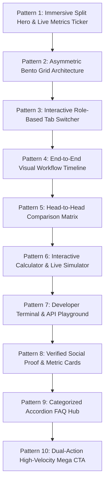

# CHIẾN LƯỢC TỔNG THỂ & HỆ THỐNG UI/UX - NỘI DUNG CHUẨN SEO E-GEAD COMPANY
> **Dự án**: E-GEAD Company Web Platform  
> **Thư mục lưu trữ**: `docs/brainstorms/`  
> **Mục tiêu**: Định hình kiến trúc nội dung chi tiết, đa dạng hóa bố cục giao diện (UI Layouts), phát triển hệ thống từ khóa SEO 2026 và mở rộng mỗi trang từ 5 đến 20 section chuẩn B2B SaaS quốc tế.  
> **Phạm vi trang**:
> 1. `/services/all-services` (Tổng hợp dịch vụ & giải pháp công nghệ)
> 2. `/speedx` (Eweb-character: AI Order Precision & Sub-24H US POD Fulfillment)
> 3. `/smartcommerce` (Eweb-platform: Unified Operations, Multi-channel Sync & Margin Control)
> 4. `/our-work` (Case Studies, Dự án thực chiến & Đo lường tăng trưởng)
> 5. `/partners` (Hệ sinh thái đối tác sàn, hạ tầng đám mây & mạng lưới vận chuyển)
> 6. `/insights` (Knowledge Hub, Cẩm nang vận hành TMĐT xuyên biên giới)
> 7. `/company` (Giới thiệu E-GEAD, DNA văn hóa, hạ tầng Buôn Ma Thuột & mạng lưới Mỹ)

---

## 1. Bối cảnh & Mục tiêu Đột phá Nội dung (Content & UI Paradigm Shift)

### 1.1. Vấn đề Hiện tại của Giao diện & Nội dung (Current Gap Analysis)
- **Quá ít Section (3-5 section/trang)**: Hiện các trang nội bộ chỉ gồm Hero + 1 Grid lặp lại + ContactBlock, tạo cảm giác như "landing page tĩnh sơ sài", chưa phản ánh tầm vóc của một công ty công nghệ & logistics quốc tế.
- **Bố cục UI đơn điệu**: Chủ yếu là các card hình chữ nhật bo tròn đơn giản (`rounded-[28px]` hoặc `rounded-[36px]`), thiếu vắng các trải nghiệm thị giác tương tác hiện đại như:
  - Bento Grids bất đối xứng (Apple / Linear style)
  - Interactive Tab Switchers (chuyển đổi tính năng theo vai trò khách hàng)
  - Live ROI & Unit Economics Calculator (công cụ tính cước, biên lợi nhuận ròng)
  - Real-time SLA Speedometer / Countdown Visualizer (đồng hồ minh chứng năng lực 24H)
  - Feature Comparison Matrix (bảng đối chiếu trực diện E-GEAD vs 3PL truyền thống)
  - Interactive Workflow Steps (luồng dữ liệu từ lúc có đơn đến khi giao khách)
  - Accordion FAQs phân loại chuyên sâu cho từng tệp khách hàng
  - Code Snippet / API Explorer (mẫu Webhook & RESTful request trực quan)
- **Mật độ Từ khóa & Chiều sâu SEO còn mỏng**: Thiếu các thuật ngữ chuyên môn cập nhật năm 2026 (TikTok Shop US LDR 4% threshold, DTF 23-inch roll-fed printing, Barcode WMS scan checkpoints, Automated Safety Stock Buffer, Multi-currency Settlement, RTO Mitigation).

### 1.2. Mục tiêu Chuẩn hóa (Standardization Targets)
1. **Mỗi trang đạt từ 8 đến 14 section chất lượng cao** (Nằm trong khung yêu cầu 5 - 20 section).
2. **Đa dạng hóa 100% mẫu giao diện (UI Patterns)**: Không có 2 section liền kề nào dùng chung một kiểu layout (xen kẽ giữa Split Hero, Bento Grid, 3-Column Feature, Comparison Table, Step Timeline, Metrics Bar, Interactive Widget, FAQ Accordion, Testimonial Slider, High-Conversion CTA).
3. **Chuẩn SEO Quốc tế (Global E-Commerce B2B Intent)**:
   - Cấu trúc thẻ H1, H2, H3 phân tầng ngữ nghĩa rõ ràng.
   - Schema Markup định hướng: `SoftwareApplication`, `Organization`, `FAQPage`, `BreadcrumbList`, `Service`.
   - Kết hợp từ khóa thương mại (Commercial/Transactional) cho thị trường US/EU và từ khóa chuyên gia (Expert/Authority) cho cộng đồng Cross-border seller tại Việt Nam & quốc tế.

---

## 2. Thư Viện UI Layouts Đa Dạng (Design System & Section Patterns)

Để loại bỏ hoàn toàn sự nhàm chán của giao diện, hệ thống brainstorm quy định 10 mẫu Section UI tiêu chuẩn được áp dụng linh hoạt cho 7 trang:

### Chi tiết 10 UI Layout Patterns:
1. **Pattern 1 - Immersive Split Hero with Live Badge & Metrics Bar**:
   - Phía trên: Tiêu đề typography siêu lớn (H1 display), gradient text neon cyan `#5EFC8D`, announcement badge bo tròn nhấp nháy pulse.
   - Phía dưới hoặc bên cạnh: Dải số liệu động (KPI ticker bar: SLA < 24h, 99.9% accuracy, 4.8x ROAS, 10,000+ orders/day).
2. **Pattern 2 - Bento Grid (Apple/Linear Style)**:
   - Lưới bất đối xứng 3x2 hoặc 4x2: 1 card to kích thước 2x2 chứa ảnh mockup hoặc biểu đồ trực quan, các card nhỏ 1x1 xung quanh chứa micro-features kèm icon neon và hover glow.
3. **Pattern 3 - Interactive Tab Switcher**:
   - Thanh chọn tab mượt mà (Seller POD vs Thương hiệu DTC vs Lập trình viên API vs Media Buyer). Khi bấm chuyển tab, nội dung, bullet points và mockup màn hình thay đổi tương ứng.
4. **Pattern 4 - Step-by-step Process Timeline**:
   - Thanh tiến trình 4-5 bước nằm ngang (Desktop) hoặc dọc (Mobile), có đường nối phát sáng neon, thể hiện chu trình xử lý đơn hàng tự động từ webhook sàn đến carrier tracking scan.
5. **Pattern 5 - Head-to-Head Comparison Matrix**:
   - Bảng so sánh trực quan giữa "E-GEAD Ecosystem" vs "3PL & Xưởng in truyền thống", sử dụng icon Checkmark xanh ngọc vs X đỏ xám, minh chứng lợi thế vượt trội về tốc độ, giá và an toàn tài khoản.
6. **Pattern 6 - Interactive Calculator / Estimator Widget**:
   - Giao diện giả lập máy tính tính toán biên lợi nhuận ròng, cước in POD trọn gói ($6 all-in) hoặc chi phí hoàn hàng tiết kiệm được nhờ Eweb-character.
7. **Pattern 7 - Code Snippet & Developer Playground**:
   - Khung đen kiểu Dark Terminal với cú pháp code highlight (cURL / Node.js / Python), hiển thị mẫu gọi API đẩy đơn POD và webhook lắng nghe sự kiện tracking.
8. **Pattern 8 - Metric Badges & Case Study Deep-Dive**:
   - Card dạng case study gồm trước/sau (Before/After), logo khách hàng, biểu đồ chỉ số tăng trưởng và trích dẫn trực tiếp của Founder.
9. **Pattern 9 - Structured FAQ Accordion**:
   - Danh sách câu hỏi thường gặp có phân loại tab (Vận hành, Kỹ thuật, Chính sách, Chi phí), hỗ trợ SEO Rich Snippet schema FAQ.
10. **Pattern 10 - High-Velocity Conversion CTA**:
    - Khối kêu gọi hành động bo cong lớn 36px, nền gradient sâu, nút CTA chính tương phản mạnh kèm cam kết ("No setup fee", "Free 14-day API sandbox", "1-on-1 Strategy call").

---

## 3. Ma Trận Từ Khóa SEO 2026 (Keyword Clusters & Search Intents)

Hệ thống tài liệu brainstorm được tối ưu theo 5 cụm từ khóa chiến lược:

| Cụm Từ Khóa (Cluster) | Từ Khóa Trọng Tâm (Primary Keywords) | Từ Khóa Mở Rộng & Chuyên Môn (LSI / Semantic Keywords) | Search Intent |
| :--- | :--- | :--- | :--- |
| **1. POD US Fulfillment & 24H SLA** | `US POD fulfillment 24 hours`, `print on demand USA fast shipping`, `TikTok Shop US POD fulfillment` | `DTF 23-inch printing`, `TikTok Shop Late Dispatch Rate 4%`, `US carrier scan under 24h`, `$6 all-in POD`, `large format direct-to-film US` | Commercial / Transactional |
| **2. Omnichannel Sync & WMS** | `multi-channel ecommerce inventory sync`, `automated order routing ecommerce`, `WMS barcode warehouse fulfillment` | `real-time stock buffer`, `prevent overselling Amazon Etsy TikTok`, `event-driven webhook OMS`, `99.9% barcode packing accuracy` | Commercial / Technical |
| **3. AI Precision & RTO Mitigation** | `AI address normalization cross border`, `reduce ecommerce return to origin`, `ecommerce fraud order detection` | `USPS address verification API`, `postal format standardization`, `automated zip code validation`, `cross-border RTO reduction` | Informational / Commercial |
| **4. Growth Ads & Unit Economics** | `ecommerce performance marketing agency`, `TikTok Shop ads scaling ROAS`, `POD profit margin calculator` | `blended ROAS 4.8x`, `CPA optimization cross border`, `landed cost per unit`, `net margin e-commerce dashboard` | Transactional |
| **5. Developer API & Architecture** | `RESTful print on demand API`, `ecommerce fulfillment webhooks`, `headless commerce integration` | `order dispatch API latency <150ms`, `automated tracking callback`, `cloud infrastructure 99.9% uptime` | Technical / Developer |

---

## 4. Mục Lục Chi Tiết Các Tệp Brainstorm Trong Thư Mục `docs/brainstorms/`

Toàn bộ 7 trang được triển khai thành các file chi tiết độc lập:

1. [01_SERVICES_ALL_SERVICES_BRAINSTORM.md](file:///c:/Develop/egead/egead-company/docs/brainstorms/01_SERVICES_ALL_SERVICES_BRAINSTORM.md): **11 Sections** chuyên sâu cho `/services/all-services`.
2. [02_SPEEDX_EWEB_CHARACTER_BRAINSTORM.md](file:///c:/Develop/egead/egead-company/docs/brainstorms/02_SPEEDX_EWEB_CHARACTER_BRAINSTORM.md): **12 Sections** bùng nổ công nghệ in 24h & AI cho `/speedx`.
3. [03_SMARTCOMMERCE_EWEB_PLATFORM_BRAINSTORM.md](file:///c:/Develop/egead/egead-company/docs/brainstorms/03_SMARTCOMMERCE_EWEB_PLATFORM_BRAINSTORM.md): **11 Sections** điều hành đa kênh & đối soát tài chính cho `/smartcommerce`.
4. [04_OUR_WORK_CASE_STUDIES_BRAINSTORM.md](file:///c:/Develop/egead/egead-company/docs/brainstorms/04_OUR_WORK_CASE_STUDIES_BRAINSTORM.md): **10 Sections** nghiên cứu tình huống thực chiến & số liệu tăng trưởng cho `/our-work`.
5. [05_PARTNERS_ECOSYSTEM_BRAINSTORM.md](file:///c:/Develop/egead/egead-company/docs/brainstorms/05_PARTNERS_ECOSYSTEM_BRAINSTORM.md): **9 Sections** hệ sinh thái đối tác sàn, logistics & cổng thanh toán cho `/partners`.
6. [06_INSIGHTS_KNOWLEDGE_BASE_BRAINSTORM.md](file:///c:/Develop/egead/egead-company/docs/brainstorms/06_INSIGHTS_KNOWLEDGE_BASE_BRAINSTORM.md): **10 Sections** thư viện tri thức, cẩm nang thị trường & công cụ tính toán cho `/insights`.
7. [07_COMPANY_ABOUT_US_BRAINSTORM.md](file:///c:/Develop/egead/egead-company/docs/brainstorms/07_COMPANY_ABOUT_US_BRAINSTORM.md): **11 Sections** tuyên ngôn thương hiệu, hành trình từ Buôn Ma Thuột đến Mỹ cho `/company`.

---
*Bản tài liệu này đóng vai trò kim chỉ nam thiết kế kiến trúc và chuẩn SEO xuyên suốt toàn bộ dự án.*
