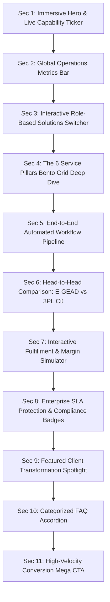

# BRAINSTORM CHI TIẾT: TRANG DỊCH VỤ TOÀN DIỆN (ALL SERVICES)
> **Trang đích**: `http://localhost:3000/services/all-services` (`app/services/all-services/page.tsx`)  
> **Định vị cốt lõi**: Trình diễn trọn bộ 6 dịch vụ chủ lực và giải pháp công nghệ vận hành - tăng trưởng thương mại điện tử xuyên biên giới của E-GEAD.  
> **Tổng số Section thiết kế**: **11 Sections** (Thỏa mãn yêu cầu: tối thiểu 5, tối đa 20 section).  
> **Đặc trưng UI/UX**: Chuyển đổi từ giao diện card đơn điệu sang hệ thống layout đa dạng: Split Hero, Live Metrics Ticker, Interactive Role Switcher, Bento Grid, Visual Workflow Steps, Head-to-Head Comparison Table, SLA Calculator Simulator, Compliance Badges, Case Spotlight, FAQ Accordion và Dual-Action Mega CTA.

---

## 1. Cấu Trúc Tổng Quan 11 Sections

---

## 2. Chi Tiết Từng Section (Layout UI, Copywriting & SEO Specs)

### Section 1: Immersive Hero & Live Capability Ticker
- **Anchor ID**: `#services-hero`
- **Mục đích UX/Chuyển đổi**: Tạo ấn tượng thị giác mạnh mẽ ngay khi tải trang; khẳng định vị thế "All-in-one E-Commerce Operations & Growth Ecosystem".
- **Bố cục UI Layout (Split Hero Pattern)**:
  - Cột trái: Badge nhấp nháy phát sáng neon `"ECOSYSTEM PORTFOLIO 2026"`, H1 cỡ lớn 64px với chữ gradient cyan `#7ceee0`, đoạn mô tả súc tích (sub-copy), 2 nút CTA (`Explore Capabilities` & `Book Technical Consultation`).
  - Cột phải: Floating Dashboard Card hiển thị đồ thị luồng xử lý đơn hàng theo thời gian thực (Real-time Order Throughput), số liệu live orders, độ trễ API 120ms.
- **Thẻ Heading & SEO Keywords**:
  - `H1`: AUTOMATE OPERATIONS. SCALE GLOBAL COMMERCE.
  - Từ khóa SEO chính: `end-to-end ecommerce operations`, `cross-border fulfillment solutions`, `ecommerce automation platform`.
- **Nội dung Copywriting**:
  - *Announcement Badge*: `● LIVE SYSTEM: 10,000+ DAILY DISPATCHES ACROSS US HUBS`
  - *Headline (H1)*: Automate Operations.  Scale Global Commerce.
  - *Sub-headline*: E-GEAD delivers an enterprise-grade technology and logistics ecosystem: automating multi-channel order pipelines, manufacturing US print-on-demand goods in under 24 hours, and scaling revenue through high-impact performance advertising.
  - *Primary CTA*: `Explore Solutions Matrix` (Anchor trượt xuống Sec 3)
  - *Secondary CTA*: `Request Operations Audit` (Liên kết `/contact-us`)

---

### Section 2: Global Operations Metrics Bar
- **Anchor ID**: `#operations-metrics`
- **Mục đích UX**: Xây dựng niềm tin tức thì (Instant Social Proof & Trust) qua các con số định lượng thực tế.
- **Bố cục UI Layout (Horizontal Metric Ticker Bar)**:
  - Khung viền mỏng bo góc `rounded-[28px]` phủ lớp nền kính mờ `#141718/80 backdrop-blur-xl`.
  - Grid 4 cột đều nhau trên Desktop, 2x2 trên Tablet/Mobile, ngăn cách bởi đường viền đứt đoạn neon mờ.
- **Dữ liệu & Copywriting**:
  1. `< 24h`: *Average US Fulfillment SLA* (Hoàn tất in ấn và quét mã vận chuyển nội địa Mỹ dưới 24 giờ).
  2. `99.9%`: *Barcode WMS Accuracy* (Độ chính xác đóng gói và dán nhãn bằng hệ thống mã vạch kho).
  3. `4.8x`: *Average Blended ROAS* (Hiệu suất hoàn vốn chi tiêu quảng cáo TikTok & Meta Ads).
  4. `$6 All-in`: *Transparent Unit Base Rate* (Mức giá sản xuất và đóng gói cố định, không phụ phí ẩn).

---

### Section 3: Interactive Role-Based Solutions Switcher
- **Anchor ID**: `#solutions-by-role`
- **Mục đích UX**: Cá nhân hóa trải nghiệm khách hàng theo 4 nhóm đối tượng chính (Cross-border POD Seller, Brand DTC, Marketer/Media Buyer, Tech/Developer).
- **Bố cục UI Layout (Interactive Tab Switcher Pattern)**:
  - Thanh tab ngang 4 nút bấm bo viên thuốc `rounded-full`. Active tab sáng đèn neon cyan nền đen, chữ trắng.
  - Khối nội dung bên dưới hiển thị theo dạng 2 cột: Cột trái liệt kê 3 nỗi đau lớn nhất và giải pháp của E-GEAD; Cột phải là hình ảnh giao diện dashboard chuyên dụng cho vai trò đó.
- **Nội dung các Tab**:
  - **Tab 1: For POD & Marketplace Sellers**:
    - *Pain Point*: Late dispatch strikes on TikTok Shop US and high return-to-origin (RTO).
    - *E-GEAD Solution*: Direct carrier scan within 24h, 23-inch DTF prints, and automated address cleansing.
    - *Key Metric*: 0% Late Dispatch Rate.
  - **Tab 2: For DTC & Omnichannel Brands**:
    - *Pain Point*: Stockouts and overselling across Shopify, Amazon, and Etsy.
    - *E-GEAD Solution*: Bidirectional inventory sync with centralized multi-channel OMS.
    - *Key Metric*: 100% Stockout Prevention.
  - **Tab 3: For Media Buyers & Growth Marketers**:
    - *Pain Point*: Rising CPAs, creative fatigue, and murky product unit economics.
    - *E-GEAD Solution*: TikTok/Meta creative testing engine paired with live net margin calculation.
    - *Key Metric*: 4.8x Average Campaign ROAS.
  - **Tab 4: For Technical Teams & Developers**:
    - *Pain Point*: Fragile CSV imports, lack of webhooks, and manual tracking uploads.
    - *E-GEAD Solution*: Open RESTful API with webhook callbacks and sub-150ms response latency.
    - *Key Metric*: 99.9% API Availability.

---

### Section 4: The 6 Service Pillars Bento Grid Deep Dive
- **Anchor ID**: `#core-services-grid`
- **Mục đích UX**: Chi tiết hóa năng lực kỹ thuật của 6 dịch vụ chủ lực theo bố cục Bento Grid hiện đại thay vì danh sách cuộn dọc nhàm chán.
- **Bố cục UI Layout (Asymmetric Bento Grid 3x2)**:
  - 6 khối card lớn bo góc `rounded-[32px]` với kích thước và điểm nhấn khác nhau, hiệu ứng hover glow cyan, icon đồ họa kỹ thuật số.
- **Thẻ Heading & SEO Keywords**:
  - `H2`: Complete Operational Spectrum: From Ingestion to Delivery & Growth
  - Từ khóa: `sales automation`, `marketplace integration`, `fulfillment automation`, `ecommerce platform development`, `cloud hosting ecommerce`, `performance advertising`.
- **Nội dung 6 Trụ Cột**:
  1. **01. Sales Automation**:
     - *Headline*: Centralized Multi-Channel Ingestion
     - *Body*: Aggregate incoming sales orders from Amazon, Etsy, TikTok Shop, and Shopify into a single automated pipeline. Normalize variant data, automate order confirmation, and eliminate 99% of manual spreadsheet workflows.
     - *Sub-capabilities*: Multi-store webhook listeners, automated fraud screening, intelligent order routing.
  2. **02. POD Marketplace Integration**:
     - *Headline*: High-Velocity US Production Link
     - *Body*: Bi-directional API bridge between global storefronts and automated US print facilities. Seamlessly dispatch 23-inch large-format print files and return tracking numbers to platforms within 12-24 hours.
     - *Sub-capabilities*: TikTok Shop US compliant API, DTF auto-ganging software, instant label generation.
  3. **03. Fulfillment Automation**:
     - *Headline*: Barcode WMS & Supply Chain Precision
     - *Body*: Digitize warehouse operations with barcode scanning at every station—picking, printing, heat pressing, quality inspection, and carrier sorting—guaranteeing 99.9% packing accuracy.
     - *Sub-capabilities*: Real-time inventory buffer, multi-facility routing, transparent $6 all-in unit economics.
  4. **04. E-Commerce Platform**:
     - *Headline*: High-Converting Storefront Engineering
     - *Body*: Custom Next.js and headless commerce storefronts engineered for sub-1.5s mobile load speeds, frictionless 1-step checkout, and seamless localization across US, UK, and European currencies.
     - *Sub-capabilities*: Dynamic cross-sells, multi-currency checkout (Stripe/PayPal), A/B testing infrastructure.
  5. **05. Website & Cloud Hosting Management**:
     - *Headline*: Enterprise Resilience & 99.9% Uptime
     - *Body*: Cloudflare Edge and AWS auto-scaling hosting infrastructure built to absorb massive traffic spikes during Black Friday and viral TikTok campaigns without performance degradation.
     - *Sub-capabilities*: DDoS shield, daily automated database snapshots, 24/7 technical observability.
  6. **06. Digital Advertising Services**:
     - *Headline*: Data-Driven Growth Marketing
     - *Body*: Full-funnel performance marketing across TikTok Shop, Meta, and Google Ads. Pairing AI-driven creative testing with rigorous unit margin modeling to scale profitable global customer acquisition.
     - *Sub-capabilities*: Short-form creative studio, automated ROAS bid management, localized market expansion.

---

### Section 5: End-to-End Automated Workflow Pipeline
- **Anchor ID**: `#workflow-pipeline`
- **Mục đích UX**: Minh họa rõ nét "Hành trình một đơn hàng" từ lúc khách bấm Mua đến khi kiện hàng được trao tận tay khách Mỹ trong 3-5 ngày.
- **Bố cục UI Layout (Step-by-Step Flowchart Pipeline)**:
  - 5 bước liên kết nhau bằng đường line phát sáng cyan kèm mũi tên động.
- **Nội dung 5 Bước**:
  - **Step 01 - Order Ingestion (< 1s)**: Webhook kích hoạt ngay khi khách đặt hàng trên TikTok Shop/Amazon/Etsy/Shopify. Đơn được kéo về Eweb-platform.
  - **Step 02 - AI Sanitization & Verification (< 3s)**: AI Eweb-character chuẩn hóa địa chỉ USPS, bổ sung Zip+4, kiểm tra rủi ro gian lận.
  - **Step 03 - Automated DTF Production (< 12h)**: File in 23-inch được gộp tự động (auto-gang), in trực tiếp trên máy công nghiệp và ép nhiệt tự động.
  - **Step 04 - Barcode QC & Scan Injection (< 20h)**: Nhân viên quét mã vạch kiểm tra thành phẩm, dán nhãn bưu điện, mã tracking được đẩy ngược lại sàn.
  - **Step 05 - Carrier Delivery (2-4 Days)**: USPS/UPS nhận kiện hàng tại hub trung chuyển, khách hàng nhận thông báo theo dõi tự động.

---

### Section 6: Head-to-Head Comparison: E-GEAD vs Traditional 3PL
- **Anchor ID**: `#comparison-matrix`
- **Mục đích UX**: Đánh thẳng vào tâm lý so sánh của khách hàng, chỉ ra điểm yếu của các đơn vị 3PL/Fulfillment truyền thống.
- **Bố cục UI Layout (Comparison Table Pattern)**:
  - Bảng so sánh 3 cột: *Tính năng/Tiêu chí* | *E-GEAD Ecosystem* (Nổi bật nền xanh đậm) | *3PL & Xưởng in truyền thống* (Nền mờ xám).
- **Nội dung So Sánh**:
  1. *Fulfillment Speed*: E-GEAD **< 24 Hours dispatch** vs 3PL cũ **3-5 Business Days** (Nguy cơ trễ SLA TikTok).
  2. *Print Format*: E-GEAD **23-inch Large-Format DTF** vs 3PL cũ **Standard 12x14 inch DTG** (Hạn chế mẫu áo oversize/streetwear).
  3. *Address Cleansing*: E-GEAD **AI-powered automated normalization** vs 3PL cũ **Manual review or raw import** (Dễ bị RTO, hủy đơn).
  4. *Multi-channel Sync*: E-GEAD **Real-time 2-way API sync** vs 3PL cũ **Batch CSV upload** (Rủi ro overselling cao).
  5. *Pricing Structure*: E-GEAD **$6 Flat All-In per unit** vs 3PL cũ **Base cost + picking fee + handling fee + packaging fee**.
  6. *Financial Reporting*: E-GEAD **Live net margin dashboard** vs 3PL cũ **End-of-month Excel statement**.

---

### Section 7: Interactive Fulfillment & Margin Simulator Mockup
- **Anchor ID**: `#margin-simulator`
- **Mục đích UX**: Kích thích tương tác (Gamification), cho phép seller tự tính toán số tiền tiết kiệm được khi chuyển sang E-GEAD.
- **Bố cục UI Layout (Interactive Calculator Card)**:
  - Thanh trượt Slider: Số lượng đơn/tháng (100 -> 10,000 đơn).
  - Tùy chọn kênh bán (TikTok Shop, Amazon, Etsy, Shopify).
  - Khung kết quả hiển thị tức thì: Số giờ làm thủ công tiết kiệm được (Hours Saved), Chi phí RTO tránh được (RTO Dollars Saved), Tỷ lệ trễ SLA (0%).
- **Copywriting**:
  - *Title*: Estimate Your Operational Freedom
  - *Callout*: "Sellers handling 1,500 monthly orders save an average of 42 operational hours and $1,260 in avoided RTO penalties every month."

---

### Section 8: Enterprise SLA Protection & Compliance Badges
- **Anchor ID**: `#sla-compliance`
- **Mục đích UX**: Giải tỏa nỗi lo lớn nhất của người bán hàng quốc tế: Bị phạt hoặc khóa tài khoản do chậm trễ hoặc vi phạm chính sách sàn.
- **Bố cục UI Layout (Badge Grid with Trust Pillars)**:
  - 4 khối bảo chứng chất lượng với icon mạ vàng/xanh neon.
- **Nội dung 4 Cam Kết**:
  1. **TikTok Shop US LDR Shield**: Đảm bảo tỷ lệ Late Dispatch Rate luôn dưới 1% (Quy định sàn < 4%), bảo toàn huy hiệu Fast Dispatch và đề xuất For You.
  2. **Amazon FBM On-Time Delivery Guarantee**: Tự động tạo tracking hợp lệ và bàn giao bưu điện đúng cam kết Valid Tracking Rate (VTR > 95%).
  3. **Data Security & Privacy**: Mã hóa dữ liệu đơn hàng 256-bit AES, tuân thủ nghiêm ngặt GDPR và California Consumer Privacy Act (CCPA).
  4. **99.9% Uptime Service Level Agreement**: Cam kết hệ thống API và máy chủ storefront không bao giờ sập vào các dịp cao điểm Q4 và Prime Day.

---

### Section 9: Featured Client Transformation Spotlight
- **Anchor ID**: `#client-spotlight`
- **Mục đích UX**: Cung cấp bằng chứng thực tế (Concrete Proof) từ một thương hiệu thời trang cụ thể.
- **Bố cục UI Layout (Split Case Study Highlight)**:
  - Cột trái: Ảnh người sáng lập và hình ảnh sản phẩm in DTF thực tế.
  - Cột phải: Câu chuyện chuyển đổi của **UrbanVibe Apparel**:
    - *Before*: 4.2% LDR trên TikTok Shop US, đối mặt nguy cơ bị giới hạn đơn hàng (Order Volume Limit - OVL).
    - *Action*: Tích hợp toàn bộ đơn hàng sang xưởng in E-GEAD US thông qua Eweb-character.
    - *Results*: Dispatch rate đạt 99.8% trong 24 giờ, LDR giảm xuống 0.2%, doanh thu Q4 tăng trưởng 180% (đạt $420,000 GMV).
    - *Founder Quote*: *"E-GEAD eliminated our sleepless nights. We scaled our TikTok Shop ad spend knowing our fulfillment would never drop the ball."*

---

### Section 10: Categorized FAQ Accordion
- **Anchor ID**: `#services-faq`
- **Mục đích UX/SEO**: Giải đáp các thắc mắc chi tiết; khai thác từ khóa tìm kiếm dài (Long-tail keywords) và hỗ trợ FAQ Schema cho Google Search.
- **Bố cục UI Layout (Expandable Accordion)**:
  - Danh sách 6 câu hỏi bấm mở mượt mà với icon `ChevronDown` xoay 180 độ.
- **Bộ Câu Hỏi - Trả Lời**:
  1. *Q: How quickly does E-GEAD dispatch US print-on-demand orders?*  
     *A: Over 95% of standard orders are printed, quality-inspected, and handed to US domestic carriers (USPS/UPS) within 12 to 24 hours of ingestion.*
  2. *Q: Can E-GEAD integrate with our existing custom ERP or OMS?*  
     *A: Yes. We offer fully documented Open RESTful APIs and real-time Webhooks that allow direct two-way synchronization with any custom ERP, WMS, or Shopify Plus store.*
  3. *Q: What is included in the $6 all-in unit rate?*  
     *A: Our $6 base rate covers the premium blank garment, 23-inch high-resolution DTF print, barcode WMS sorting, standard packaging, and labor with zero hidden handling fees.*
  4. *Q: How does E-GEAD safeguard our TikTok Shop account health?*  
     *A: By ensuring physical carrier origin scans occur well within TikTok Shop's 48-hour SLA deadline, keeping your Late Dispatch Rate (LDR) far below the 4% penalty ceiling.*
  5. *Q: What ad channels does your digital growth team manage?*  
     *A: We specialize in TikTok Shop Ads, Meta (Facebook/Instagram), and Google Shopping / Performance Max campaigns, focusing on direct customer acquisition and ROAS optimization.*
  6. *Q: Is there any minimum order quantity (MOQ) to get started?*  
     *A: No MOQ. Whether you produce 10 orders a day or 5,000 orders during peak holiday seasons, E-GEAD scales elastically to match your demand.*

---

### Section 11: High-Velocity Conversion Mega CTA
- **Anchor ID**: `#services-cta`
- **Mục đích UX**: Chốt đơn chuyển đổi cho người dùng sau khi đã xem toàn bộ năng lực dịch vụ.
- **Bố cục UI Layout (Contrasting Glow Card 36px)**:
  - Nền đen sâu viền gradient cyan `#7ceee0/40`, typography kích thước lớn, 2 nút hành động rõ ràng.
- **Nội dung Copywriting**:
  - *Heading*: Ready to Automate Your Operations and Dominate Global Sales?
  - *Sub-text*: Connect with our e-commerce solutions architects today. Get a complimentary operations audit and review your custom unit economics in under 24 hours.
  - *Buttons*:
    - Button 1: `Schedule Operations Consultation` (Primary neon button)
    - Button 2: `View Live Sandbox Documentation` (Secondary outline button)

---
*Tài liệu này xác lập cấu trúc 11 section toàn diện, nâng cấp vượt bậc so với phiên bản 3 section cũ.*
