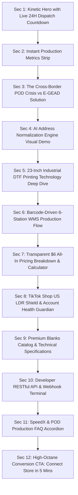

# BRAINSTORM CHI TIẾT: TRANG SPEEDX / EWEB-CHARACTER (AI ORDER PRECISION & 24H US POD FULFILLMENT)
> **Trang đích**: `http://localhost:3000/speedx` (`app/speedx/page.tsx`)  
> **Định vị sản phẩm**: **Eweb-character** - Động cơ AI thông minh chuẩn hóa dữ liệu đơn hàng xuyên biên giới, triệt tiêu lỗi địa chỉ hoàn hàng (RTO) kết hợp xưởng in công nghệ cao hoàn tất đơn POD tại Mỹ dưới 24 giờ với giá trọn gói $6 all-in.  
> **Tổng số Section thiết kế**: **12 Sections** (Vượt trội hoàn toàn so với 3 section cũ).  
> **Đặc trưng UI/UX**: Tích hợp đồng hồ đếm ngược SLA 24 giờ thời gian thực, widget mô phỏng làm sạch địa chỉ trước/sau (Interactive Before/After Address Cleaner), sơ đồ công nghệ in cuộn DTF 23-inch, máy tính cước $6 all-in, dark terminal code API và thư viện phôi áo cao cấp.

---

## 1. Cấu Trúc Tổng Quan 12 Sections

---

## 2. Chi Tiết Từng Section (Layout UI, Copywriting & SEO Specs)

### Section 1: Kinetic Hero with Live 24H Dispatch Countdown
- **Anchor ID**: `#speedx-hero`
- **Mục đích UX**: Đánh trúng nỗi sợ lớn nhất của seller (chậm đơn, trễ SLA, khóa shop) bằng cam kết trực diện: Sản xuất và giao bưu điện Mỹ dưới 24 giờ.
- **Bố cục UI Layout (Interactive Kinetic Split Hero)**:
  - Cột trái: Pill badge neon xanh `"PROPELLED BY EWEB-CHARACTER AI"`, Tiêu đề H1 cỡ lớn, đoạn mô tả giá trị cốt lõi, 2 nút bấm (`Connect Storefront` & `Test Address AI`).
  - Cột phải: Thẻ tương tác **Live 24H SLA Countdown Simulator**. Đồng hồ đếm ngược `23:59:42` minh họa quá trình: Đơn nhận lúc 08:00 AM -> In lúc 11:30 AM -> Quét bưu điện lúc 03:45 PM cùng ngày.
- **Thẻ Heading & SEO Keywords**:
  - `H1`: Eweb-character: AI Precision.  Sub-24H US POD Fulfillment.
  - Từ khóa SEO: `24 hour POD fulfillment USA`, `TikTok Shop compliant POD`, `AI address normalization ecommerce`, `DTF print on demand US`.
- **Copywriting**:
  - *Headline (H1)*: Eweb-character: AI Precision.  Sub-24H US POD Fulfillment.
  - *Sub-headline*: Eliminate return-to-origin (RTO) with proprietary AI address correction, print oversized 23-inch DTF graphics on industrial machinery, and dispatch orders to US domestic carriers in under 24 hours from just $6 all-in.
  - *CTAs*: `Start Fulfilling in 24H` (Primary) | `View Live Address Demo` (Anchor xuống Sec 4).

---

### Section 2: Instant Production Metrics Strip
- **Anchor ID**: `#speedx-metrics`
- **Mục đích UX**: Chứng minh quy mô và độ tin cậy vận hành bằng số liệu thực.
- **Bố cục UI Layout (Glassmorphism Stat Cards)**:
  - Grid 4 thẻ thống kê nằm ngang với hiệu ứng ánh sáng gradient viền.
- **Dữ liệu & Copywriting**:
  1. `< 18.4 Hours`: *Median Order Turnaround Time* (Thời gian trung bình từ khi nhận webhook đến lúc bàn giao USPS/UPS).
  2. `23 Inches`: *Maximum Print Width* (Khổ in DTF công nghiệp lớn nhất thị trường cho thiết kế tràn áo).
  3. `0.2%`: *Average Late Dispatch Rate (LDR)* (Thấp hơn 20 lần so với trần phạt 4% của TikTok Shop US).
  4. `-82%`: *Drop in Address-Related RTO* (Giảm thiểu đơn hoàn do lỗi sai định dạng địa chỉ Mỹ).

---

### Section 3: The Cross-Border POD Crisis vs E-GEAD Solution
- **Anchor ID**: `#the-pod-crisis`
- **Mục đích UX**: Nêu bật nỗi đau thị trường (Market Friction) và định vị E-GEAD là giải pháp cứu cánh tối thượng.
- **Bố cục UI Layout (2-Column Problem/Solution Grid)**:
  - Cột trái (The Legacy Trap - Nền đen viền đỏ/xám mờ):
    - *3-5 Day Print Delays*: Khách chờ lâu, tỷ lệ hủy đơn cao.
    - *TikTok Shop Account Bans*: Bị dính gậy LDR > 4%, giảm hiển thị feed hoặc khóa shop vĩnh viễn.
    - *Hidden Fees*: Giá quảng cáo $4 nhưng cộng thêm phí dập mác $1, phí đóng gói $1.5, phí xử lý $1.
    - *Format Limitations*: Chỉ in được khổ nhỏ A4/A3 (12x14 inch), không in được áo oversize.
  - Cột phải (The Eweb-character Standard - Nền đen viền cyan phát sáng `#5EFC8D`):
    - *Guaranteed Sub-24H Production*: Bàn giao bưu điện trong ngày, bảo vệ 100% tài khoản.
    - *Proprietary AI Address Cleansing*: Tự động sửa lỗi Zip, tên đường, bang trước khi in.
    - *Transparent $6 Flat All-In*: Một giá duy nhất, không phụ phí ẩn.
    - *23-Inch Large Format DTF*: In tràn viền, màu sắc sống động trên mọi chất liệu vải.

---

### Section 4: AI Address Normalization Engine Visual Demo
- **Anchor ID**: `#ai-address-normalization`
- **Mục đích UX**: Cho người dùng thấy cơ chế hoạt động của thuật toán Eweb-character (Product Explainer thông qua UI mô phỏng).
- **Bố cục UI Layout (Interactive Comparison Mockup Card)**:
  - Khung chia đôi: Cột trái "Incoming Raw Marketplace Payload" (Dữ liệu lỗi từ khách mua), Cột phải "Eweb-character AI Sanitized Output" (Dữ liệu đã chuẩn hóa CASS USPS).
- **Ví dụ Minh họa Trực quan**:
  - *Raw Input (Dễ gây RTO)*:
    - Name: `Jhn Smth`
    - Address: `apt 4b 125 n main st`
    - City: `new york` | State: `ny` | Zip: `1000` (Thiếu số)
    - *Risk Score*: `High (92% Delivery Failure Risk)`
  - *AI Sanitized Output (Chuẩn hóa 100%)*:
    - Name: `John Smith`
    - Address: `125 N Main St Apt 4B`
    - City: `New York` | State: `NY` | Zip+4: `10001-2834`
    - Carrier Route: `C012` | Validation: `USPS DPV Confirmed Delivery Point`
    - *Status*: `Auto-approved for Instant Production`

---

### Section 5: 23-Inch Industrial DTF Printing Technology Deep Dive
- **Anchor ID**: `#dtf-technology`
- **Mục đích UX**: Thuyết phục các brand thời trang khó tính về chất lượng in ấn đỉnh cao (Superior Print Quality).
- **Bố cục UI Layout (Bento Tech Showcase 3 Khối)**:
  - Khối 1 (Card lớn): Sơ đồ máy in cuộn DTF khổ lớn 24-inch, công nghệ đầu phun Epson i3200 kép, phủ bột keo và sấy nhiệt tự động.
  - Khối 2: Minh họa so sánh độ bền giặt (Wash Durability): Chịu được 60+ lần giặt không bong tróc, đàn hồi kéo giãn 4 chiều.
  - Khối 3: Bảng phân tích màu sắc: Gam màu mở rộng CMYK + White + Fluorescent, độ phân giải 2400 DPI, chi tiết sắc nét ngay cả nét mảnh 0.5mm.

---

### Section 6: Barcode-Driven 6-Station WMS Production Flow
- **Anchor ID**: `#wms-production-flow`
- **Mục đích UX**: Minh chứng tính minh bạch và kỷ luật công nghiệp qua quy trình 6 trạm kiểm soát mã vạch.
- **Bố cục UI Layout (Horizontal Flow Cards with Glow Connectors)**:
  - 6 trạm nối tiếp nhau với icon trạng thái và thời gian xử lý:
    1. *Station 1: API Intake & Auto-Ganging* (Ghép file in thông minh tiết kiệm film cuộn)
    2. *Station 2: High-Speed DTF Roll Printing* (In liên tục với mực gốc nước thân thiện môi trường)
    3. *Station 3: Automated Shaker & Oven Curing* (Rắc bột nóng chảy và sấy nhiệt tự động)
    4. *Station 4: Carousel Heat Pressing* (Ép nhiệt công nghiệp lên áo trong 15 giây)
    5. *Station 5: Optical & Barcode QC Inspection* (Camera AI quét lỗi in và đối chiếu mã vạch đơn)
    6. *Station 6: Automated Labeling & Carrier Hand-Off* (Dán nhãn bưu điện và đưa vào xe tải vận chuyển)

---

### Section 7: Transparent $6 All-In Pricing Breakdown & Calculator
- **Anchor ID**: `#pricing-calculator`
- **Mục đích UX**: Xóa tan sự mập mờ về giá; chứng minh E-GEAD giúp người bán tối đa hóa biên lợi nhuận ròng.
- **Bố cục UI Layout (Interactive Pricing Matrix & Profit Slider)**:
  - Cột 1: Bảng phân rã chi tiết những gì đã bao gồm trong gói $6 (Phôi áo cao cấp, in 23-inch, kiểm tra chất lượng, túi zip mờ, phí nhân công).
  - Cột 2: Widget tính lợi nhuận ròng:
    - Nhập giá bán lẻ dự kiến (Ví dụ: $24.99).
    - Trừ chi phí E-GEAD ($6.00) + Phí sàn TikTok Shop ($1.50) + Phí ship nội địa US ($4.50) = **Lợi nhuận ròng: $12.99/áo (Biên lợi nhuận 52%)**.

---

### Section 8: TikTok Shop US LDR Shield & Account Health Guardian
- **Anchor ID**: `#tiktok-sla-shield`
- **Mục đích UX**: Nhấn mạnh vai trò là "Tấm khiên bảo vệ tài khoản" trước chính sách ngặt nghèo của TikTok Shop US năm 2026.
- **Bố cục UI Layout (Split Feature with Policy Callout)**:
  - Khối trích dẫn chính sách TikTok Shop Seller Center 2026: Late Dispatch Rate (LDR) phải <= 4% và yêu cầu Physical Origin Scan trong 2 ngày làm việc.
  - Giải pháp E-GEAD: Cam kết Physical Scan trong vòng 24 giờ. Cơ chế tự động ưu tiên đơn sắp chạm mốc 24h, kèm chính sách hoàn tiền 100% nếu phát sinh lỗi trễ do xưởng in.

---

### Section 9: Premium Blanks Catalog & Technical Specifications
- **Anchor ID**: `#blanks-catalog`
- **Mục đích UX**: Cung cấp danh mục phôi áo tiêu chuẩn sẵn sàng trong kho Mỹ (Không lo thiếu hàng khi scale chiến dịch).
- **Bố cục UI Layout (Product Spec Grid 4 Cột)**:
  - 4 dòng sản phẩm chủ lực:
    1. *Classic Heavyweight Tee (Gildan 5000 / Shaka Wear)*: 100% Cotton, 5.3 oz, bền bỉ, phong cách streetwear.
    2. *Vintage Garment-Dyed Tee (Comfort Colors 1717)*: 100% Ringspun Cotton, 6.1 oz, chất vải mềm, phong cách retro washed.
    3. *Retail-Fit Unisex Tee (Bella+Canvas 3001)*: 100% Airlume Combed Cotton, 4.2 oz, form tôn dáng hiện đại.
    4. *Heavy Blend Fleece Hoodie & Crewneck (Gildan 18500 / 18000)*: 50/50 Poly-Cotton, 8.0 oz, lớp nỉ êm ái cho mùa thu đông.
  - Mỗi thẻ hiển thị: Bảng màu có sẵn (30+ màu), dải size (S - 5XL), và thời gian có sẵn trong kho (In-stock 100%).

---

### Section 10: Developer RESTful API & Webhook Terminal
- **Anchor ID**: `#api-terminal`
- **Mục đích UX**: Thu hút nhóm khách hàng doanh nghiệp và đội ngũ kỹ sư muốn tự động hóa hoàn toàn luồng đẩy đơn.
- **Bố cục UI Layout (Dark Terminal IDE with Syntax Highlighting)**:
  - Cửa sổ mã nguồn giao diện Dark Mode với các tab: `POST /v1/orders/dispatch`, `Webhook: order.in_transit`, `GET /v1/inventory/blanks`.
  - Mẫu payload JSON trực quan cho thấy tốc độ tiếp nhận đơn chỉ trong 85ms và tự động phản hồi `tracking_number` và `carrier: "USPS"`.

---

### Section 11: SpeedX & POD Production FAQ Accordion
- **Anchor ID**: `#speedx-faq`
- **Mục đích UX/SEO**: Giải đáp các thắc mắc chuyên sâu về quy trình in ấn và chính sách hoàn tiền.
- **Bố cục UI Layout (Accordion Collapsible List)**:
  - 6 câu hỏi then chốt:
    1. *What file formats do you accept for 23-inch printing?* (Hỗ trợ PNG, TIFF, PDF 300 DPI với nền trong suốt RGB/CMYK).
    2. *What happens if an order is delayed past 24 hours?* (Cam kết bồi hoàn phí in và miễn phí xử lý đơn hàng).
    3. *How does the AI address normalization handle international names?* (Tự động chuyển đổi ký tự có dấu, chuẩn hóa theo cơ sở dữ liệu bưu chính quốc tế).
    4. *Do you provide custom neck labels and packaging inserts?* (Hỗ trợ in nhãn cổ áo không tem và chèn thiệp cảm ơn theo yêu cầu của brand).
    5. *What carriers do you use for domestic US delivery?* (Sử dụng USPS Ground Advantage, Priority Mail, UPS Ground và DHL eCommerce).
    6. *Can I test sample prints before launching my store?* (Cung cấp gói Sample Pack kiểm tra chất lượng vải và màu in trong 2 ngày).

---

### Section 12: High-Octane Conversion CTA: Connect Store in 5 Mins
- **Anchor ID**: `#speedx-cta`
- **Mục đích UX**: Kêu gọi người dùng đăng ký kết nối gian hàng ngay lập tức với ưu đãi mẫu in thử.
- **Bố cục UI Layout (Dual Action Mega Card)**:
  - Typography mạnh mẽ: "Stop Losing Money on Print Delays and High RTO."
  - Ưu đãi: `Claim 10 Free Sample Prints + 14-Day Full Access to Eweb-character AI`.
  - Hai nút bấm: `Connect Your Storefront Now` và `Talk to a Production Specialist`.

---
*Bản thiết kế này biến `/speedx` thành một cỗ máy bán hàng công nghệ cao với 12 section toàn diện.*
