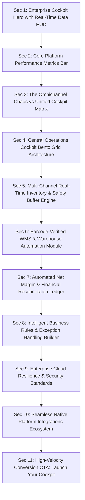

# BRAINSTORM CHI TIẾT: TRANG SMARTCOMMERCE / EWEB-PLATFORM (UNIFIED OPERATIONS & MARGIN CONTROL)
> **Trang đích**: `http://localhost:3000/smartcommerce` (`app/smartcommerce/page.tsx`)  
> **Định vị sản phẩm**: **Eweb-platform** - Bảng điều khiển trung tâm (Operations Cockpit) hợp nhất mọi luồng đơn hàng đa kênh, tự động đồng bộ tồn kho thời gian thực, quản trị kho WMS bằng mã vạch và đối soát biên lợi nhuận ròng tức thì không cần dùng bảng tính Excel.  
> **Tổng số Section thiết kế**: **11 Sections** (Nâng cấp vượt trội từ 3 section đơn sơ ban đầu).  
> **Đặc trưng UI/UX**: Mô phỏng giao diện Dashboard buồng lái điều hành (Operations Cockpit), ma trận đồng bộ đa sàn thời gian thực, bảng tính biên lợi nhuận ròng (Net Margin Ledger), bộ quy tắc điều phối đơn hàng thông minh (Automated Business Rule Builder), kiến trúc đám mây an toàn và cổng kết nối hệ sinh thái sàn TMĐT.

---

## 1. Cấu Trúc Tổng Quan 11 Sections

---

## 2. Chi Tiết Từng Section (Layout UI, Copywriting & SEO Specs)

### Section 1: Enterprise Cockpit Hero with Real-Time Data HUD
- **Anchor ID**: `#platform-hero`
- **Mục đích UX**: Định vị Eweb-platform là "Bộ não trung tâm" của toàn bộ doanh nghiệp thương mại điện tử, giúp nhà sáng lập và giám đốc vận hành làm chủ mọi biến động.
- **Bố cục UI Layout (Split Hero with Live HUD Mockup)**:
  - Cột trái: Badge màu ngọc bích `"CENTRALIZED COMMERCE OS"`, Tiêu đề H1 lớn, đoạn mô tả giải pháp, 2 nút CTA (`Launch Live Demo` & `Book Architecture Review`).
  - Cột phải: Card đồ họa mô phỏng buồng lái điều hành (Operations Cockpit HUD): Hiển thị biểu đồ luồng đơn hàng chảy về từ Amazon, Etsy, TikTok Shop và Shopify với các chấm tín hiệu màu xanh nhấp nháy báo trạng thái "Syncing in 0.8s".
- **Thẻ Heading & SEO Keywords**:
  - `H1`: Eweb-platform: Unified Operations.  Master Multi-Channel Margins.
  - Từ khóa SEO: `multi-channel ecommerce management platform`, `real time inventory sync`, `ecommerce operations cockpit`, `automated margin reconciliation`.
- **Nội dung Copywriting**:
  - *Headline (H1)*: Eweb-platform: Unified Operations.  Master Multi-Channel Margins.
  - *Sub-headline*: Connect every storefront, warehouse fulfillment node, and financial settlement stream into a single high-velocity operations cockpit. Eliminate manual spreadsheets, prevent stockout cancellations, and monitor net profit margins in real time.
  - *CTAs*: `Explore Cockpit Demo` (Primary neon) | `View Integration Hub` (Anchor xuống Sec 10).

---

### Section 2: Core Platform Performance Metrics Bar
- **Anchor ID**: `#platform-metrics`
- **Mục đích UX**: Chứng minh hiệu năng xử lý dữ liệu ở quy mô lớn (High-throughput & Real-time).
- **Bố cục UI Layout (4-Column Metric Ribbon)**:
  - Khung kính mờ bo tròn `rounded-[28px]`, viền phát sáng nhẹ.
- **Dữ liệu & Copywriting**:
  1. `< 1.2s`: *Real-Time Inventory Sync Latency* (Tốc độ cập nhật số lượng kho lên mọi gian hàng ngay khi có đơn mới).
  2. `0%`: *Overselling Incidents* (Triệt tiêu hoàn toàn tình trạng bán vượt số lượng tồn thực tế).
  3. `15+ Hours/Week`: *Saved on Manual Spreadsheets* (Cắt giảm thời gian tổng hợp file Excel đơn hàng và công nợ).
  4. `99.99%`: *System High-Availability Uptime* (Hạ tầng đám mây hoạt động liên tục không gián đoạn).

---

### Section 3: The Omnichannel Chaos vs Unified Cockpit Matrix
- **Anchor ID**: `#omnichannel-chaos`
- **Mục đích UX**: Làm rõ sự khác biệt một trời một vực giữa cách vận hành thủ công chắp vá và hệ thống vận hành tập trung của E-GEAD.
- **Bố cục UI Layout (Split Contrast Grid)**:
  - Cột trái ("The Disconnected Nightmare" - Tông màu tối, viền đỏ/xám):
    - Đăng nhập 6 trang quản trị khác nhau mỗi sáng (Seller Central, TikTok Seller Center, Etsy Shop Manager, Shopify Admin...).
    - Dùng 10 file Google Sheets nối công thức VLOOKUP để kiểm tra tồn kho, thường xuyên lỗi dữ liệu.
    - Bị phạt trừ điểm do hủy đơn hàng hết tồn kho trên sàn.
    - Không rõ một đơn hàng thực tế lãi bao nhiêu tiền sau khi trừ chi phí in, ship và hoa hồng sàn.
  - Cột phải ("The Eweb-platform Standard" - Nền đen viền xanh cyan `#7ceee0`):
    - Một màn hình duy nhất kiểm soát 100% đơn hàng và tồn kho đa kênh.
    - Cập nhật kho tự động hai chiều qua API trong 1 giây.
    - Cơ chế Safety Stock Buffer thông minh bảo vệ gian hàng khỏi overselling trong các dịp Flash Sale.
    - Bảng báo cáo tự động tính toán chính xác biên lợi nhuận ròng cho từng SKU theo thời gian thực.

---

### Section 4: Central Operations Cockpit Bento Grid Architecture
- **Anchor ID**: `#cockpit-bento-grid`
- **Mục đích UX**: Trình diễn các module chức năng cốt lõi của Eweb-platform theo phong cách Bento Grid hiện đại.
- **Bố cục UI Layout (Bento Grid 4 Card Bất Đối Xứng)**:
  - **Card 1 (Khổ lớn 2x2)**: *Live Global Order Queue* - Luồng tổng hợp đơn hàng đa sàn với bộ lọc trạng thái (Chờ xác nhận, Đang in, Đã đóng gói, Đang giao).
  - **Card 2 (1x1)**: *Bi-directional Inventory Bridge* - Tự động đồng bộ tồn kho giữa kho blank tại Mỹ và các kênh bán lẻ.
  - **Card 3 (1x1)**: *Automated Fraud & Address Flagging* - Cảnh báo tự động các đơn hàng có địa chỉ nghi vấn hoặc rủi ro chargeback cao.
  - **Card 4 (2x1)**: *Instant Carrier Dispatch Console* - Tự động tạo và dán mã bưu điện USPS, UPS, FedEx với chi phí cước rẻ nhất.

---

### Section 5: Multi-Channel Real-Time Inventory & Safety Buffer Engine
- **Anchor ID**: `#inventory-buffer-engine`
- **Mục đích UX**: Giải thích cơ chế kỹ thuật giúp người bán an tâm tuyệt đối khi chạy quảng cáo quy mô lớn.
- **Bố cục UI Layout (Interactive Architecture Diagram)**:
  - Sơ đồ trực quan: Kho trung tâm (Central Inventory Pool) -> Thuật toán Dynamic Safety Stock Buffer -> Phân bổ tỷ lệ tồn kho ảo thông minh lên Amazon (40%), TikTok Shop (40%), Etsy (20%).
- **Copywriting**:
  - *Headline*: Intelligent Dynamic Stock Buffering
  - *Body*: When running viral TikTok campaigns, sudden sales velocity can drain inventory before other channels update. Eweb-platform dynamically reserves safety stock buffers, automatically setting secondary channels to "Low Stock" or pausing listings before an overselling event occurs, safeguarding your seller ratings.

---

### Section 6: Barcode-Verified WMS & Warehouse Automation Module
- **Anchor ID**: `#wms-automation-module`
- **Mục đích UX**: Thuyết phục các khách hàng có kho riêng hoặc dùng mạng lưới kho E-GEAD về tính chuẩn xác tuyệt đối.
- **Bố cục UI Layout (3-Column Feature Cards with Tech Badges)**:
  - Thẻ 1: *Barcode Receiving & Blank Auditing* - Quét mã vạch kiểm đếm phôi áo đầu vào, phân loại theo màu sắc, size và vị trí kệ hàng (Bin/Location).
  - Thẻ 2: *Pick-to-Light & Smart Batching* - Tự động gom các đơn có cùng mẫu thiết kế hoặc cùng màu áo để in hàng loạt, tối ưu 40% năng suất máy in.
  - Thẻ 3: *Optical QC Scan & Automated Weighing* - Cân điện tử và quét mã vạch trước khi đóng gói; nếu trọng lượng sai lệch quá 10g, hệ thống tự động giữ lại để nhân viên kiểm tra, loại bỏ 99.9% lỗi gửi nhầm size hoặc nhầm mẫu.

---

### Section 7: Automated Net Margin & Financial Reconciliation Ledger
- **Anchor ID**: `#financial-ledger`
- **Mục đích UX**: Đáp ứng nhu cầu sống còn của các nhà sáng lập: Kiểm soát dòng tiền và biên lợi nhuận ròng thực tế.
- **Bố cục UI Layout (Interactive Financial Table & Profit Ledger Mockup)**:
  - Giao diện giả lập bảng đối soát tài chính minh bạch cho từng đơn hàng:
    - *Column 1*: Order ID (`#TK-89214`) & Platform (`TikTok Shop US`)
    - *Column 2*: Gross Customer Payment (`$29.99`)
    - *Column 3*: E-GEAD Print & Fulfillment Cost (`-$6.00`)
    - *Column 4*: US Domestic Postage (`-$4.20`)
    - *Column 5*: Marketplace Commission Fee (`-$1.80`)
    - *Column 6*: Attributed Ad Spend CPA (`-$8.50`)
    - *Column 7*: **True Net Profit: +$9.49 (31.6% Net Margin)**
  - Nút tải báo cáo thuế và đối soát P&L tự động chỉ với một cú nhấp chuột (Export CSV/QuickBooks).

---

### Section 8: Intelligent Business Rules & Exception Handling Builder
- **Anchor ID**: `#rules-engine`
- **Mục đích UX**: Thể hiện tính linh hoạt và khả năng tự động hóa không giới hạn của nền tảng (No-code Automation Builder).
- **Bố cục UI Layout (Visual If-This-Then-That Workflow Blocks)**:
  - Minh họa các kịch bản tự động hóa phổ biến:
    - *Rule 1*: IF Order Value > $100 -> THEN Auto-upgrade shipping to USPS Priority Mail & add VIP branded packing insert.
    - *Rule 2*: IF Destination = Alaska/Hawaii -> THEN Route to specialized regional fulfillment carrier to avoid delivery surcharges.
    - *Rule 3*: IF Buyer Zip Code is unconfirmed by USPS CASS -> THEN Send automated SMS asking customer to verify address within 6 hours.

---

### Section 9: Enterprise Cloud Resilience & Security Standards
- **Anchor ID**: `#cloud-security`
- **Mục đích UX**: Xây dựng sự an tâm cho các thương hiệu lớn về an toàn thông tin và bảo mật dữ liệu khách hàng.
- **Bố cục UI Layout (Security Trust Grid with Shield Icons)**:
  - 4 tiêu chuẩn bảo mật hàng đầu:
    1. *End-to-End TLS 1.3 & AES-256 Data Encryption* (Bảo vệ toàn bộ thông tin thanh toán và địa chỉ người mua).
    2. *Cloudflare Enterprise DDoS Protection* (Lọc sạch các cuộc tấn công mạng và bot thu thập dữ liệu giá).
    3. *Role-Based Access Control (RBAC)* (Phân quyền chi tiết cho nhân viên: Xem đơn, Quản lý kho, Đối soát kế toán).
    4. *Continuous Data Replication & Automated Disaster Recovery* (Sao lưu dữ liệu định kỳ mỗi 15 phút trên nhiều vùng địa lý).

---

### Section 10: Seamless Native Platform Integrations Ecosystem
- **Anchor ID**: `#platform-integrations`
- **Mục đích UX**: Khẳng định khả năng tương thích 100% với các nền tảng thương mại điện tử hiện tại của khách hàng.
- **Bố cục UI Layout (Interactive Logo Grid & Connector Status)**:
  - 8 khối đối tác sàn và cổng công nghệ:
    - *TikTok Shop US*: Native Open API, 2-way order and tracking sync.
    - *Amazon FBM & Seller Central*: MWS/SP-API compliant integration.
    - *Etsy*: Direct OAuth 2.0 integration for listing and order routing.
    - *Shopify & Shopify Plus*: 1-click App store install, real-time webhooks.
    - *WooCommerce*: REST API plugin with auto-sync catalog.
    - *eBay*: Automated fulfillment notifications and live tracking dispatch.
    - *Walmart Marketplace*: High-volume seller compliant inventory bridge.
    - *Stripe & Regional Gateways*: Automated ledger synchronization for direct payment reconciliation.

---

### Section 11: High-Velocity Conversion CTA: Launch Your Cockpit
- **Anchor ID**: `#platform-cta`
- **Mục đích UX**: Thúc đẩy người dùng bắt đầu dùng thử hoặc đặt lịch tư vấn di chuyển dữ liệu.
- **Bố cục UI Layout (High-Conversion Glow Card 36px)**:
  - *Headline*: Take Full Control of Your E-Commerce Velocity Today.
  - *Callout*: Start your 14-day free operations trial. Seamlessly migrate your store data in less than 30 minutes with our dedicated onboarding engineering team.
  - *Actions*: `Start 14-Day Free Trial` | `Book Guided Onboarding Demo`.

---
*Tài liệu này xác lập cấu trúc 11 section biến `/smartcommerce` thành một trang giới thiệu Platform công nghệ đẳng cấp thế giới.*
