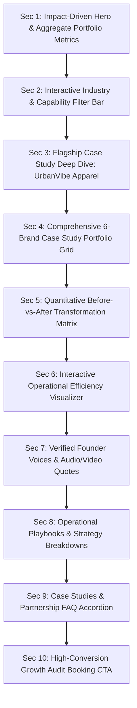

# BRAINSTORM CHI TIẾT: TRANG DỰ ÁN THỰC CHIẾN (OUR WORK / CASE STUDIES)
> **Trang đích**: `http://localhost:3000/our-work` (`app/our-work/page.tsx`)  
> **Định vị cốt lõi**: Bằng chứng tăng trưởng thực chiến (Proof of Scale & Measurable ROI) từ các thương hiệu thương mại điện tử quốc tế đã tự động hóa vận hành và bứt phá doanh số cùng E-GEAD.  
> **Tổng số Section thiết kế**: **10 Sections** (Nâng cấp vượt bậc từ 3 section ban đầu).  
> **Đặc trưng UI/UX**: Dải số liệu tăng trưởng tổng hợp (Aggregate Growth Ticker), bộ lọc danh mục tương tác, Case Study tiêu biểu toàn màn hình (Flagship Deep Dive), lưới dự án mở rộng 6 thương hiệu, bảng đối chiếu Before/After định lượng, trích dẫn âm thanh/video của Founder, cẩm nang chiến lược tải về và khối đặt lịch kiểm toán vận hành (Growth Audit).

---

## 1. Cấu Trúc Tổng Quan 10 Sections

---

## 2. Chi Tiết Từng Section (Layout UI, Copywriting & SEO Specs)

### Section 1: Impact-Driven Hero & Aggregate Portfolio Metrics
- **Anchor ID**: `#work-hero`
- **Mục đích UX**: Gây ấn tượng mạnh mẽ với các đối tác lớn bằng kết quả kinh doanh định lượng thực tế (Aggregated Proof).
- **Bố cục UI Layout (Split Hero with Live Portfolio Counter)**:
  - Cột trái: Badge neon `"PROVEN GLOBAL CASE STUDIES"`, Tiêu đề H1 lớn, đoạn mô tả triết lý thực chiến ("We measure success in net profits, SLA safety, and hours saved").
  - Cột phải: Khung kính mờ hiển thị 4 con số tổng hợp tích lũy từ hơn 100 dự án đã triển khai:
    - `+$45M`: *Gross Merchandise Value (GMV) Generated*
    - `100+`: *Brands Accelerated Across 10+ Countries*
    - `99.8%`: *Aggregate On-Time Dispatch SLA Rate*
    - `0%`: *Account Health Violations Across Partners*
- **Thẻ Heading & SEO Keywords**:
  - `H1`: Measurable Growth.  Battle-Tested Results.
  - Từ khóa SEO: `ecommerce case studies`, `tiktok shop us success story`, `pod fulfillment case study`, `cross-border scaling results`.

---

### Section 2: Interactive Industry & Capability Filter Bar
- **Anchor ID**: `#case-study-filters`
- **Mục đích UX**: Giúp người xem lọc nhanh các case study đúng với mô hình kinh doanh và nỗi đau hiện tại của họ.
- **Bố cục UI Layout (Pill-Button Navigation Bar)**:
  - Thanh cuộn tab ngang bo tròn `rounded-full` với số lượng case study hiển thị bên cạnh mỗi thẻ:
    1. *All Success Stories (6)*
    2. *POD US Fulfillment & 24H SLA (2)*
    3. *Multi-Channel Inventory Sync (2)*
    4. *Performance Ads & ROAS Scale (1)*
    5. *Enterprise WMS & API Integration (1)*

---

### Section 3: Flagship Case Study Deep Dive: UrbanVibe Apparel
- **Anchor ID**: `#flagship-case-study`
- **Mục đích UX**: Đi sâu vào một câu chuyện thành công điển hình nhất để tạo cảm xúc đồng cảm và khao khát đạt kết quả tương tự.
- **Bố cục UI Layout (Full-Bleed Split Showcase)**:
  - Nền đen sang trọng viền cyan neon, chia 2 cột:
    - Cột trái: Hình ảnh sản phẩm streetwear, ảnh kho hàng US đóng gói kiện hàng với tem bưu điện USPS.
    - Cột phải: Phân tích 3 pha chuyển đổi ngoạn mục của **UrbanVibe Apparel (Los Angeles, US)**:
      - *The Operational Bottleneck*: Tỷ lệ giao hàng trễ (LDR) trên TikTok Shop chạm ngưỡng 4.2%, tài khoản nhận cảnh báo giới hạn 100 đơn/ngày từ thuật toán sàn.
      - *The E-GEAD Intervention*: Chuyển đổi toàn bộ lệnh in sang công nghệ DTF 23-inch tại kho E-GEAD US; áp dụng Eweb-character tự động lọc địa chỉ.
      - *The Quantitative Outcome*: 100% đơn hàng được quét mã bưu điện dưới 24 giờ; LDR giảm về 0.18%; Doanh thu Q4 tăng vọt 180% đạt **$420,000 GMV** mà không phát sinh thêm một nhân sự vận hành nào.

---

### Section 4: Comprehensive 6-Brand Case Study Portfolio Grid
- **Anchor ID**: `#case-studies-grid`
- **Mục đích UX**: Trình bày danh mục dự án đa dạng ngành hàng, từ thời trang, quà tặng, đồ gia dụng đến nền tảng công nghệ quy mô lớn.
- **Bố cục UI Layout (2-Column Large Card Grid with Image Zoom Effect)**:
  - 6 thẻ dự án hoàn chỉnh gồm:
    1. **UrbanVibe Apparel (US)** - *POD Fashion*: Sub-24H Dispatch SLA & TikTok Fast Dispatch Badge (+180% Q4 Revenue).
    2. **HomeCraft Studio (US & UK)** - *Home Living & Custom Gifts*: Tự động hóa đồng bộ 1,500 SKU giữa Amazon, Etsy và Shopify (-85% thời gian thủ công, 0% overselling).
    3. **Lumina DTC Brand (Global)** - *Performance Fashion*: Tối ưu chiến dịch TikTok & Meta Ads bứt phá Blended ROAS lên 4.8x và giảm CPA xuống $8.4.
    4. **PrintWave Enterprise Network** - *API Infrastructure*: Xử lý hơn 10,000 đơn POD mỗi ngày qua Open RESTful API với độ trễ phản hồi < 120ms.
    5. **Nordic Threads (Germany & Scandinavia)** - *Apparel & Merch*: Mở rộng bán hàng xuyên lục địa vào thị trường Mỹ với chi phí in cố định $6 all-in, đạt biên lợi nhuận ròng 34%.
    6. **AuraGlow Custom Decor (Australia)** - *Personalized Decor*: Triệt tiêu 91% đơn hoàn RTO tại thị trường Mỹ nhờ thuật toán AI chuẩn hóa địa chỉ bưu chính CASS.

---

### Section 5: Quantitative Before-vs-After Transformation Matrix
- **Anchor ID**: `#transformation-matrix`
- **Mục đích UX**: Định lượng hóa giá trị mà E-GEAD mang lại qua bảng so sánh Trước và Sau khi hợp tác.
- **Bố cục UI Layout (Comparison Data Grid with Up/Down Trend Badges)**:
  - Bảng 4 dòng trực quan với icon xu hướng (Mũi tên xanh giảm chi phí/rủi ro, mũi tên xanh tăng lợi nhuận):
    1. *TikTok Shop Late Dispatch Rate (LDR)*: Trước **4.5% (High Risk)** -> Sau **0.2% (SLA Safe Shield)**.
    2. *Weekly Hours Spent on Manual CSVs*: Trước **18.5 Hours/Week** -> Sau **1.2 Hours/Week (-93%)**.
    3. *Address-Related Return-to-Origin (RTO)*: Trước **6.8% of Total Orders** -> Sau **0.9% of Total Orders (-87%)**.
    4. *Average Advertising Blended ROAS*: Trước **2.1x Break-Even** -> Sau **4.8x Sustainable Scale (+128%)**.

---

### Section 6: Interactive Operational Efficiency Visualizer
- **Anchor ID**: `#efficiency-visualizer`
- **Mục đích UX**: Cho phép người dùng trực tiếp kéo thanh trượt để thấy đồ thị tăng trưởng quy mô khi loại bỏ điểm nghẽn thủ công.
- **Bố cục UI Layout (Interactive Slider & Live Chart)**:
  - Thanh trượt điều chỉnh số lượng đơn hàng từ 500 đến 20,000 đơn/tháng.
  - Đồ thị so sánh: Chi phí nhân sự vận hành truyền thống tăng phi mã theo số đơn, trong khi chi phí với E-GEAD duy trì đường thẳng phẳng (Flat cost curve), giúp tối đa hóa lợi nhuận khi mở rộng quy mô.

---

### Section 7: Verified Founder Voices & Audio/Video Quotes
- **Anchor ID**: `#founder-voices`
- **Mục đích UX**: Tạo cảm giác gần gũi, chân thực qua đánh giá của các nhà sáng lập thương hiệu thực tế.
- **Bố cục UI Layout (3-Column Testimonial Quote Cards with Audio/Video Badges)**:
  - Thẻ 1: **Marcus Vance**, Founder tại UrbanVibe (Mỹ): *"Without E-GEAD's sub-24h fulfillment, our TikTok Shop account would have been suspended in November. They didn't just fulfill orders—they saved our entire company."*
  - Thẻ 2: **Elena Rostova**, Operations Director tại HomeCraft Studio (Anh): *"Syncing stock across Etsy and Amazon was our worst daily headache. Eweb-platform automated everything. We haven't opened an inventory spreadsheet in 8 months."*
  - Thẻ 3: **David Nguyen**, Co-Founder tại Lumina DTC (Việt Nam / Toàn cầu): *"Scaling ads past $5,000/day used to terrify us because our old print partner couldn't keep up. With E-GEAD's $6 all-in rate and 24h capacity, we scaled to $25,000/day with complete confidence."*

---

### Section 8: Operational Playbooks & Strategy Breakdowns
- **Anchor ID**: `#operational-playbooks`
- **Mục đích UX**: Tặng tài liệu giá trị chuyên môn cao để thu hút khách hàng tiềm năng để lại thông tin liên hệ.
- **Bố cục UI Layout (Resource Download Cards)**:
  - 3 cẩm nang thực chiến tải về miễn phí:
    1. *The 2026 TikTok Shop US SLA Survival Guide (PDF)*: Bí quyết duy trì LDR < 1% và thuật toán phân phối For You.
    2. *The Omnichannel Inventory Blueprint (PDF)*: Hướng dẫn thiết lập bộ đệm Safety Stock Buffer đa sàn.
    3. *Unit Economics Master Sheet (Excel/Notion)*: Bảng mẫu tính toán chi phí in, ship và biên lợi nhuận ròng chuẩn xác.

---

### Section 9: Case Studies & Partnership FAQ Accordion
- **Anchor ID**: `#case-studies-faq`
- **Mục đích UX/SEO**: Giải đáp các câu hỏi về quy trình triển khai dự án mẫu và cam kết kết quả.
- **Bố cục UI Layout (Accordion Collapsible)**:
  - 5 câu hỏi then chốt:
    1. *How quickly can our store replicate these results?* (Hầu hết các brand hoàn tất tích hợp và đạt mốc 24h dispatch trong vòng 3 đến 5 ngày làm việc).
    2. *Are these case study metrics verified by third-party platforms?* (Tất cả số liệu đều được trích xuất trực tiếp từ TikTok Shop Seller Center, Amazon Central và Stripe/Shopify Analytics).
    3. *Do you work with startups or only established brands?* (E-GEAD đồng hành cùng cả các brand mới khởi nghiệp từ vài chục đơn/ngày đến các doanh nghiệp quy mô 10,000+ đơn/ngày).
    4. *What happens if our sales spike 10x overnight during a viral campaign?* (Hạ tầng in ấn công nghiệp và mạng lưới kho của chúng tôi được thiết kế để co giãn tức thì, đáp ứng đột biến đơn mà không cần thông báo trước).
    5. *Can we sign an NDA before sharing our store data?* (E-GEAD luôn ký thỏa thuận bảo mật NDA nghiêm ngặt để bảo vệ 100% tài sản trí tuệ và danh mục sản phẩm của khách hàng).

---

### Section 10: High-Conversion Growth Audit Booking CTA
- **Anchor ID**: `#work-cta`
- **Mục đích UX**: Kêu gọi người dùng đăng ký buổi kiểm toán vận hành 1-kèm-1 miễn phí.
- **Bố cục UI Layout (Contrasting Glow Card 36px)**:
  - *Headline*: Ready to Write Your Own Growth Story?
  - *Sub-text*: Schedule a confidential 30-minute operations audit with our senior solutions engineers. We will analyze your current fulfillment bottlenecks, calculate your exact unit economics savings, and map out a sub-24h scaling roadmap.
  - *CTAs*: `Claim Your Free Operations Audit` | `Explore Technical Documentation`.

---
*Tài liệu này xác lập cấu trúc 10 section hoàn chỉnh, biến `/our-work` thành một trung tâm bảo chứng năng lực thuyết phục nhất.*
