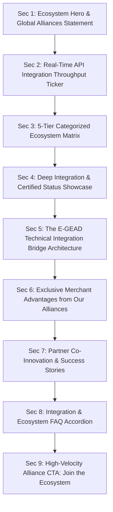

# BRAINSTORM CHI TIẾT: TRANG ĐỐI TÁC CHIẾN LƯỢC (PARTNERS ECOSYSTEM)
> **Trang đích**: `http://localhost:3000/partners` (`app/partners/page.tsx`)  
> **Định vị cốt lõi**: Hệ sinh thái kết nối toàn diện (Global Commerce Alliances & Tech Ecosystem) - Khẳng định vị thế của E-GEAD khi tích hợp trực tiếp, sâu rộng với các sàn thương mại điện tử lớn nhất hành tinh, mạng lưới bưu chính Mỹ, các nền tảng quảng cáo và hạ tầng thanh toán quốc tế.  
> **Tổng số Section thiết kế**: **9 Sections** (Gấp 3 lần cấu trúc 3 section sơ sài cũ).  
> **Đặc trưng UI/UX**: Hero biểu trưng hệ sinh thái, ticker đo lường lưu lượng API thời gian thực, ma trận phân loại 5 tầng đối tác (5-Tier Categorized Hub), card chứng nhận đối tác chuyên sâu (Certified Badges), sơ đồ kiến trúc cầu nối tích hợp (Integration Bridge Architecture), khối quyền lợi độc quyền cho người bán, cổng đăng ký đối tác mới và khối CTA phát triển mở rộng.

---

## 1. Cấu Trúc Tổng Quan 9 Sections

---

## 2. Chi Tiết Từng Section (Layout UI, Copywriting & SEO Specs)

### Section 1: Ecosystem Hero & Global Alliances Statement
- **Anchor ID**: `#partners-hero`
- **Mục đích UX**: Khẳng định quy mô hợp tác quốc tế, xóa bỏ tâm lý e ngại về tính tương thích công nghệ của người bán.
- **Bố cục UI Layout (Split Hero with Floating Integration Cloud)**:
  - Cột trái: Badge neon `"GLOBAL COMMERCE ALLIANCES 2026"`, H1 cỡ lớn, đoạn giới thiệu tầm nhìn hệ sinh thái tích hợp không ma sát.
  - Cột phải: Khối đồ họa động hiển thị logo E-GEAD ở trung tâm, kết nối bằng các tia sáng neon lan tỏa tới logo của TikTok Shop, Amazon, Etsy, Shopify, Google, Meta, USPS và Stripe.
- **Thẻ Heading & SEO Keywords**:
  - `H1`: Integrated with the World's  Leading Commerce Ecosystems.
  - Từ khóa SEO: `ecommerce marketplace integrations`, `tiktok shop api partner`, `amazon sp-api integration`, `shopify pod fulfillment partner`, `usps commercial shipping partner`.
- **Nội dung Copywriting**:
  - *Headline (H1)*: Integrated with the World's  Leading Commerce Ecosystems.
  - *Sub-headline*: E-GEAD bridges your business directly with the world's most powerful marketplaces, storefront technologies, advertising platforms, and national logistics networks. Seamless, secure, and fully automated operations from day one.
  - *CTAs*: `Explore Partner Matrix` | `Become an Ecosystem Partner`.

---

### Section 2: Real-Time API Integration Throughput Ticker
- **Anchor ID**: `#api-throughput`
- **Mục đích UX**: Chứng minh hạ tầng API chịu tải cao và độ tin cậy kết nối liên tục.
- **Bố cục UI Layout (4-Column Live Metric Ribbon)**:
  - Khung kính mờ bo tròn `rounded-[28px]`:
    1. `< 120ms`: *Average API Response Latency* (Độ trễ xử lý các lệnh đẩy đơn và nhận tracking).
    2. `10,000,000+`: *Monthly Webhook Events Processed* (Khối lượng sự kiện dữ liệu luân chuyển an toàn mỗi tháng).
    3. `100%`: *OAuth 2.0 & Token Compliance* (Bảo mật xác thực tuyệt đối, không lưu trữ mật khẩu nhạy cảm).
    4. `99.9%`: *End-to-End Delivery Carrier Scan Rate* (Tỷ lệ bưu kiện nhận được mã quét nguồn thành công).

---

### Section 3: 5-Tier Categorized Ecosystem Matrix
- **Anchor ID**: `#ecosystem-matrix`
- **Mục đích UX**: Giúp người xem khám phá toàn cảnh hệ sinh thái theo từng lĩnh vực chuyên biệt.
- **Bố cục UI Layout (Tabbed Category Grid)**:
  - 5 tab phân loại rõ ràng:
    - **Tier 1: Global Marketplaces**: TikTok Shop US, Amazon Global Selling, Etsy, eBay, Walmart Marketplace.
    - **Tier 2: Storefront Platforms**: Shopify & Shopify Plus, WooCommerce, BigCommerce, Custom Headless Next.js.
    - **Tier 3: Advertising & Growth Networks**: Meta Ads (Facebook & Instagram), TikTok Ads Manager, Google Performance Max & YouTube Shopping.
    - **Tier 4: Logistics & Carrier Networks**: United States Postal Service (USPS), United Parcel Service (UPS), FedEx Domestic, DHL eCommerce.
    - **Tier 5: Payment Rails & Financial Security**: Stripe Payments, PayPal International, Apple Pay, Google Pay, Automated Currency Hedging.

---

### Section 4: Deep Integration & Certified Status Showcase
- **Anchor ID**: `#certified-showcase`
- **Mục đích UX**: Trình bày chi tiết cấp độ tích hợp sâu của các đối tác chủ lực, chứng minh E-GEAD không chỉ "nói suông" mà sở hữu quan hệ đối tác kỹ thuật chính thức.
- **Bố cục UI Layout (Bento Grid 6 Thẻ Đối Tác Cao Cấp)**:
  1. **TikTok Shop US (Certified Fast Dispatch Partner)**:
     - Tích hợp 2 chiều trực tiếp qua Open API.
     - Tự động đẩy mã tracking trong 12-24h, bảo toàn huy hiệu "Fast Dispatch" và giữ tỷ lệ LDR luôn dưới 1%.
  2. **Amazon (Selling Partner API - SP-API Certified)**:
     - Đồng bộ kho hàng tự động, tự động xác nhận đơn hàng FBM, bảo đảm chỉ số Valid Tracking Rate (VTR > 95%).
  3. **Etsy & eBay (Direct Multi-Variant Catalog Bridge)**:
     - Tự động phân tách các thuộc tính đơn hàng phức tạp (Size, Color, Custom Text), hỗ trợ đẩy trực tiếp file in 23-inch vào xưởng.
  4. **Shopify & Shopify Plus (Verified App Infrastructure)**:
     - Cài đặt 1 chạm qua Shopify App Store. Tự động lắng nghe webhook `orders/create`, tự động cập nhật fulfillment status tức thì.
  5. **USPS Commercial Plus Carrier Network**:
     - Kết nối trực tiếp hệ thống manifest bưu cục Mỹ, hưởng giá cước thương mại ưu đãi nhất cho dịch vụ USPS Ground Advantage và Priority Mail.
  6. **Meta & Google Growth Alliances**:
     - Tích hợp Conversions API (CAPI) và Google Enhanced Conversions, tối ưu thuật toán AI phân phối quảng cáo chính xác đến tệp khách mua có giá trị cao.

---

### Section 5: The E-GEAD Technical Integration Bridge Architecture
- **Anchor ID**: `#bridge-architecture`
- **Mục đích UX**: Thuyết phục các chuyên gia công nghệ và doanh nghiệp lớn bằng sơ đồ luồng dữ liệu bảo mật, tốc độ cao.
- **Bố cục UI Layout (Interactive Flow Architecture Diagram)**:
  - Sơ đồ 4 khối phát sáng:
    - `Input Rails`: Các gian hàng (Amazon, TikTok, Shopify) phát lệnh webhook.
    - `Security Gateway`: E-GEAD Ingestion Gateway mã hóa dữ liệu 256-bit, kiểm tra chống trùng lặp đơn (Idempotency).
    - `Execution Core`: Eweb-platform phân loại đơn, Eweb-character làm sạch địa chỉ, tự động điều phối xưởng in US.
    - `Output Rails`: Trả mã tracking về sàn và gửi thông báo theo dõi cho người mua cuối cùng.

---

### Section 6: Exclusive Merchant Advantages from Our Alliances
- **Anchor ID**: `#merchant-advantages`
- **Mục đích UX**: Trả lời câu hỏi: "Tôi bán hàng thông qua E-GEAD thì được lợi ích thực tế gì hơn so với tự làm việc với từng sàn/hãng ship?"
- **Bố cục UI Layout (3-Column Benefit Cards)**:
  1. *Commercial Postage Discounts*: Tiết kiệm từ $1.50 - $3.00 trên mỗi kiện hàng nhờ hợp đồng sản lượng lớn của E-GEAD với USPS và UPS.
  2. *Priority Policy Escalation*: Kênh hỗ trợ kỹ thuật ưu tiên trực tiếp với đội ngũ chính sách của TikTok Shop US và Amazon khi xảy ra sự cố thuật toán.
  3. *Early Access Alpha Features*: Tiếp cận trước các tính năng mới của sàn như TikTok Live Shopping Automation, Amazon Custom Print APIs và Meta Instant Checkout.

---

### Section 7: Partner Co-Innovation & Success Stories
- **Anchor ID**: `#partner-stories`
- **Mục đích UX**: Minh chứng sự hợp tác chặt chẽ mang lại giá trị đôi bên giữa E-GEAD và các nhà phát triển công nghệ.
- **Bố cục UI Layout (Split Feature Card with Partner Quotes)**:
  - Lời chứng thực từ Giám đốc Đối tác Logistics Bắc Mỹ:
    - *"E-GEAD's high-speed barcode manifest scanning ensures that thousands of packages enter our sortation facilities perfectly organized and 100% compliant with origin scan windows. They set the benchmark for modern cross-border fulfillment efficiency."*

---

### Section 8: Integration & Ecosystem FAQ Accordion
- **Anchor ID**: `#partners-faq`
- **Mục đích UX/SEO**: Giải đáp các thắc mắc về quyền riêng tư dữ liệu và quy trình kết nối API.
- **Bố cục UI Layout (Expandable Accordion)**:
  - 5 câu hỏi cốt lõi:
    1. *Does E-GEAD share or sell our store customer data?* (Tuyệt đối không. Chúng tôi ký cam kết bảo mật pháp lý, chỉ xử lý dữ liệu để phục vụ việc in ấn và vận chuyển theo chuẩn GDPR/CCPA).
    2. *How long does it take to connect a new TikTok Shop or Shopify store?* (Chỉ mất dưới 5 phút thông qua giao diện cấp quyền OAuth 2.0 an toàn).
    3. *Can we connect multiple stores from different platforms to one E-GEAD account?* (Có. Bạn có thể kết nối không giới hạn số lượng gian hàng TikTok, Amazon, Etsy và Shopify vào cùng một bảng điều khiển trung tâm).
    4. *What happens if a marketplace API experiences downtime?* (Hệ thống E-GEAD có hàng đợi tự động Retry Queue với chiến lược Exponential Backoff, đảm bảo không có đơn hàng nào bị thất lạc khi sàn gặp sự cố).
    5. *Are there any ongoing API connection fees?* (Hoàn toàn miễn phí kết nối API và không có phí duy trì hàng tháng cho các sàn đối tác chuẩn).

---

### Section 9: High-Velocity Alliance CTA: Join the Ecosystem
- **Anchor ID**: `#partners-cta`
- **Mục đích UX**: Thu hút thêm các nhà phát triển ứng dụng, đối tác cung ứng phôi áo và đơn vị vận chuyển gia nhập mạng lưới.
- **Bố cục UI Layout (Contrasting Glow Card 36px)**:
  - *Headline*: Expand Your Reach Within the E-GEAD Global Network.
  - *Sub-text*: Are you a software vendor, logistics provider, or marketplace platform? Partner with E-GEAD to deliver unprecedented operational velocity to thousands of high-growth global merchants.
  - *CTAs*: `Apply for Technology Partnership` | `Access Developer Sandbox`.

---
*Tài liệu này xác lập cấu trúc 9 section phong phú, khẳng định vị thế hệ sinh thái công nghệ toàn diện của E-GEAD.*
