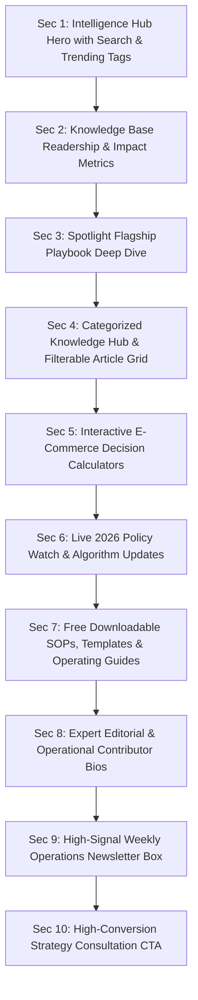

# BRAINSTORM CHI TIẾT: TRANG GÓC NHÌN & CẨM NANG TRI THỨC (INSIGHTS & KNOWLEDGE BASE)
> **Trang đích**: `http://localhost:3000/insights` (`app/insights/page.tsx`)  
> **Định vị cốt lõi**: Trung tâm tri thức thương mại điện tử xuyên biên giới hàng đầu (Cross-Border E-Commerce Intelligence Hub) - Nơi xuất bản các cẩm nang chiến lược thực chiến, phân tích cập nhật thuật toán sàn năm 2026, giải pháp quản trị SLA kho bãi và tối ưu biên lợi nhuận ròng.  
> **Tổng số Section thiết kế**: **10 Sections** (Nâng cấp vượt bậc từ 3 section ban đầu).  
> **Đặc trưng UI/UX**: Hero tích hợp thanh tìm kiếm thông minh và thẻ chủ đề thịnh hành (Trending Topic Pills), bài viết tiêu điểm toàn màn hình (Spotlight Flagship Playbook), lưới bài viết đa chuyên mục có bộ lọc mượt mà, công cụ tính toán chiến lược tương tác (Interactive Decision Calculators), bảng tin cảnh báo chính sách sàn (Policy Watch Bulletin), thư viện biểu mẫu SOP tải về, đội ngũ tác giả chuyên gia và hộp đăng ký nhận bản tin phân tích độc quyền.

---

## 1. Cấu Trúc Tổng Quan 10 Sections

---

## 2. Chi Tiết Từng Section (Layout UI, Copywriting & SEO Specs)

### Section 1: Intelligence Hub Hero with Search & Trending Tags
- **Anchor ID**: `#insights-hero`
- **Mục đích UX**: Biến trang blog thông thường thành một thư viện tra cứu kiến thức chuyên môn cao cấp cho các nhà bán hàng quốc tế.
- **Bố cục UI Layout (Search-First Interactive Hero)**:
  - Cột trái / Trên: Badge neon `"KNOWLEDGE BASE & INDUSTRY PLAYBOOKS"`, Tiêu đề H1 ấn tượng, thanh tìm kiếm từ khóa với icon kính lúp và nút "Filter Insights".
  - Bên dưới: Dải thẻ chủ đề thịnh hành (Trending Tags): `#TikTokShopSLA`, `#Sub24hFulfillment`, `#DTFPrinting`, `#MultiChannelSync`, `#ROASOptimization`, `#BarcodeWMS`.
- **Thẻ Heading & SEO Keywords**:
  - `H1`: Cross-Border Commerce.  Strategies & Playbooks.
  - Từ khóa SEO: `cross-border ecommerce insights`, `tiktok shop us sla guide`, `pod fulfillment playbooks`, `ecommerce inventory sync strategies`, `landed cost optimization`.
- **Nội dung Copywriting**:
  - *Headline (H1)*: Cross-Border Commerce.  Strategies & Playbooks.
  - *Sub-headline*: Actionable operational blueprints for high-velocity merchants: master TikTok Shop US dispatch compliance, automate multi-channel warehouse fulfillment, protect seller account health, and maximize net profitability.

---

### Section 2: Knowledge Base Readership & Impact Metrics
- **Anchor ID**: `#readership-metrics`
- **Mục đích UX**: Tạo uy tín chuyên gia (Thought Leadership & Authority) thông qua cộng đồng độc giả đông đảo.
- **Bố cục UI Layout (4-Column Stat Bar)**:
  - Khung kính mờ bo góc `rounded-[28px]`:
    1. `15,000+`: *Active Cross-Border Sellers Reading Monthly*
    2. `100%`: *Field-Tested Strategies (Zero Theoretical Fluff)*
    3. `Weekly`: *Real-Time Marketplace Algorithm & Policy Audits*
    4. `4.9 / 5.0`: *Content Value Rating from E-Commerce Operators*

---

### Section 3: Spotlight Flagship Playbook Deep Dive
- **Anchor ID**: `#spotlight-playbook`
- **Mục đích UX**: Dẫn dắt người đọc vào bài nghiên cứu sâu sắc nhất, thể hiện năng lực dẫn dắt ngành của E-GEAD.
- **Bố cục UI Layout (Full-Bleed Featured Article Card 36px)**:
  - Chia 2 cột: Ảnh minh họa chụp macro quy trình in và vận hành xưởng US; Cột phải tóm lược nội dung bài viết tiêu điểm:
    - *Tag*: `FEATURED PLAYBOOK · 10 MIN READ`
    - *Title*: **The 2026 Global E-Commerce Playbook: Expanding Across US, UK, and Australian Marketplaces Without Operational Collapse**
    - *Abstract*: How modern omnichannel sellers orchestrate 5,000+ monthly orders across Amazon, Etsy, and TikTok Shop using automated WMS routing, sub-24h domestic US manufacturing, and dynamic safety stock buffers.
    - *Action*: `Read Full Executive Playbook` (Liên kết `/articles/expanding-cross-border-ecommerce-playbook`).

---

### Section 4: Categorized Knowledge Hub & Filterable Article Grid
- **Anchor ID**: `#articles-grid`
- **Mục đích UX**: Cho phép người đọc duyệt qua các bài viết chuyên sâu được phân loại khoa học theo 4 nhóm chuyên đề.
- **Bố cục UI Layout (Filter Tabs + 2-Column Responsive Card Grid)**:
  - 4 Tab lọc: *All Articles*, *SLA & Logistics*, *Tech & WMS*, *Financial Strategy & Ads*.
  - Danh sách 6 bài viết chuyên sâu:
    1. **Conquering TikTok Shop US**: How Sub-24h Fulfillment Eliminates Late Dispatch Penalties (LDR < 4% rule breakdown).
    2. **Achieving 99.9% Fulfillment Accuracy**: Why Barcode WMS is Essential for High-Volume Sellers.
    3. **Mastering E-Commerce Unit Economics**: Flat-Rate $6 All-In POD and Net Margin Protection.
    4. **AI-Driven Address Normalization**: How Cleansing USPS Data Prevents 85% of Costly Cross-Border Returns.
    5. **Scaling TikTok Shop & Meta Ads to 4.8x ROAS**: Data-driven creative testing frameworks for apparel brands.
    6. **Architecting Multi-Channel Stock Synchronization**: Eliminating overselling across Amazon, Etsy, and Shopify.

---

### Section 5: Interactive E-Commerce Decision Calculators
- **Anchor ID**: `#interactive-calculators`
- **Mục đích UX**: Tăng thời gian lưu trang (Time on Page) và tương tác người dùng bằng các công cụ tính toán tiện ích.
- **Bố cục UI Layout (Bento Grid 2 Công Cụ)**:
  - **Công cụ 1: TikTok Shop SLA Risk Assessor**:
    - Nhập số đơn trung bình/ngày và thời gian xử lý xưởng in hiện tại (1 ngày, 2 ngày, 3+ ngày).
    - Hệ thống cảnh báo mức độ rủi ro bị khóa tài khoản hoặc giới hạn đơn (Order Volume Limit - OVL).
  - **Công cụ 2: True Net Profit Per Unit Estimator**:
    - Nhập giá bán, chi phí in ấn dự kiến, cước vận chuyển và chi phí ads (CPA) -> Hệ thống tự động tính ra biên lợi nhuận ròng thực tế sau khi trừ phí sàn.

---

### Section 6: Live 2026 Policy Watch & Algorithm Updates
- **Anchor ID**: `#policy-watch`
- **Mục đích UX**: Cung cấp giá trị "sống còn" cho người bán hàng quốc tế: Luôn cập nhật thay đổi luật chơi của các sàn thương mại điện tử lớn.
- **Bố cục UI Layout (Timeline / Live Bulletin Feed)**:
  - 3 bản tin cảnh báo chính sách mới nhất:
    - *TikTok Shop Policy Alert (June 2026)*: Thay đổi công thức tính LDR gộp cả đơn chưa giao quá hạn; bắt buộc quét bưu tá thật trong 48h.
    - *USPS Carrier Rate Update*: Tối ưu cách tính cước theo thể tích (Dimensional Weight) cho gói hàng quần áo dưới 1 lb.
    - *Amazon FBM VTR Enforcement*: Thắt chặt yêu cầu quét mã theo dõi hợp lệ đạt trên 95% đối với các đơn hàng hoàn tất tại Mỹ.

---

### Section 7: Free Downloadable SOPs, Templates & Operating Guides
- **Anchor ID**: `#downloadable-templates`
- **Mục đích UX**: Thu thập khách hàng tiềm năng chất lượng cao (Lead Generation) thông qua tài liệu chuyên nghiệp.
- **Bố cục UI Layout (3-Column Resource Box with Download Buttons)**:
  1. *Sub-24H Dispatch Operational SOP (PDF Checklist)*: Bản quy trình 8 bước chuẩn hóa kho hàng đạt tiêu chuẩn in và gửi hàng trong 24 giờ.
  2. *Omnichannel Net Margin Excel Model (XLSX)*: Bảng tính công thức đối soát tài chính đa kênh được thiết lập sẵn.
  3. *Cross-Border Address Validation Guidelines (Cheat Sheet)*: Cẩm nang định dạng địa chỉ bưu chính Mỹ, Canada, Anh và Châu Âu.

---

### Section 8: Expert Editorial & Operational Contributor Bios
- **Anchor ID**: `#editorial-team`
- **Mục đích UX**: Tăng điểm tín nhiệm E-E-A-T (Experience, Expertise, Authoritativeness, Trustworthiness) cho SEO Google.
- **Bố cục UI Layout (Team Contributor Cards with Social Links)**:
  - Giới thiệu các chuyên gia chắp bút:
    - *Lead Solutions Architect*: Chuyên gia 8+ năm thiết kế hệ thống WMS và tích hợp Open API đa sàn.
    - *Head of US Fulfillment Operations*: Giám đốc vận hành chuỗi xưởng in DTF công nghiệp tại Mỹ.
    - *Principal Growth Marketing Strategist*: Chuyên gia hoạch định chiến dịch quảng cáo TikTok Shop và Meta Ads đạt doanh số triệu đô.

---

### Section 9: High-Signal Weekly Operations Newsletter Box
- **Anchor ID**: `#newsletter-box`
- **Mục đích UX**: Xây dựng kênh liên lạc trực tiếp (Owned Audience) với hàng nghìn chủ doanh nghiệp e-commerce.
- **Bố cục UI Layout (Email Capture Card with Neon Accents)**:
  - *Headline*: Get Zero-Fluff Operations Intelligence Every Tuesday.
  - *Callout*: Join 15,000+ global merchants receiving our weekly analysis on marketplace policy changes, fulfillment SLA strategies, and profitable product niches.
  - *Form*: Input field `Enter your work email` + Nút `Subscribe to Playbooks`. Cam kết không spam, hủy đăng ký bất kỳ lúc nào.

---

### Section 10: High-Conversion Strategy Consultation CTA
- **Anchor ID**: `#insights-cta`
- **Mục đích UX**: Chuyển đổi độc giả thành khách hàng sử dụng dịch vụ sau khi họ đã nhận thấy giá trị chuyên môn sâu sắc của E-GEAD.
- **Bố cục UI Layout (High-Conversion Glow Card 36px)**:
  - *Headline*: Need Personalized Operational Guidance for Your Brand?
  - *Sub-text*: Don't let fulfillment bottlenecks or platform policy shifts stall your growth. Schedule a 1-on-1 strategy session with our cross-border operations team today.
  - *CTAs*: `Book a 1-on-1 Strategy Session` | `Explore Our Full Services Portfolio`.

---
*Bản thiết kế này biến `/insights` thành một trung tâm tri thức và cỗ máy thu hút khách hàng tiềm năng 10 section chuẩn SEO.*
