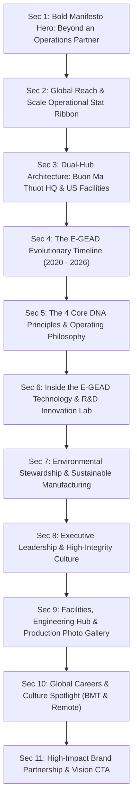

# BRAINSTORM CHI TIẾT: TRANG GIỚI THIỆU DOANH NGHIỆP (COMPANY / ABOUT US)
> **Trang đích**: `http://localhost:3000/company` (`app/company/page.tsx`)  
> **Định vị cốt lõi**: "More Than An Operations Partner, Driving Global Scale" - Câu chuyện tự hào về một công ty công nghệ & vận hành xuất sắc khởi nguồn từ Buôn Ma Thuột (Đắk Lắk, Việt Nam), kết hợp mạng lưới xưởng in công nghệ cao tại Mỹ để nâng tầm hàng nghìn thương hiệu thương mại điện tử trên toàn thế giới.  
> **Tổng số Section thiết kế**: **11 Sections** (Nâng cấp vượt bậc từ 5 section cơ bản cũ).  
> **Đặc trưng UI/UX**: Tuyên ngôn thương hiệu ấn tượng, dải số liệu toàn cầu, bản đồ hạ tầng 2 trung tâm (Buon Ma Thuot HQ & US Fulfillment Hubs), dòng thời gian phát triển (Interactive Timeline), 4 giá trị DNA cốt lõi, phòng lab nghiên cứu công nghệ R&D, cam kết sản xuất bền vững & bảo vệ môi trường, văn hóa đội ngũ, thư viện ảnh cơ sở vật chất, khối tuyển dụng và lời kêu gọi hợp tác chiến lược.

---

## 1. Cấu Trúc Tổng Quan 11 Sections

---

## 2. Chi Tiết Từng Section (Layout UI, Copywriting & SEO Specs)

### Section 1: Bold Manifesto Hero: Beyond an Operations Partner
- **Anchor ID**: `#company-hero`
- **Mục đích UX**: Truyền cảm hứng và xác lập vị thế khác biệt: E-GEAD không phải là một đơn vị gia công đơn thuần, mà là đối tác chiến lược đồng hành cùng sự thịnh vượng của khách hàng.
- **Bố cục UI Layout (Split Hero with Global Map Glow)**:
  - Cột trái: Badge neon `"OUR IDENTITY & GLOBAL MISSION"`, Tiêu đề H1 lớn, đoạn tuyên ngôn sứ mệnh.
  - Cột phải: Bản đồ toàn cầu trừu tượng với các đường nối phát sáng neon biểu thị luồng kết nối liên lục địa giữa **Buôn Ma Thuột Tech Hub** và **các xưởng in tại Bờ Đông / Bờ Tây nước Mỹ**.
- **Thẻ Heading & SEO Keywords**:
  - `H1`: More Than An Operations Partner.  Driving Global Scale.
  - Từ khóa SEO: `about E-GEAD Company`, `Buon Ma Thuot ecommerce technology`, `US POD fulfillment network`, `cross-border operations company Vietnam`.
- **Nội dung Copywriting**:
  - *Headline (H1)*: More Than An Operations Partner.  Driving Global Scale.
  - *Sub-headline*: Founded in Buon Ma Thuot, Vietnam, with high-velocity fulfillment facilities across the United States, E-GEAD empowers e-commerce brands across 10+ countries to automate complex retail workflows, fulfill print-on-demand orders in under 24 hours, and expand fearlessly into global markets.
  - *CTAs*: `Explore Our Journey` | `Meet Our Leadership`.

---

### Section 2: Global Reach & Scale Operational Stat Ribbon
- **Anchor ID**: `#company-metrics`
- **Mục đích UX**: Chứng minh quy mô hoạt động và sức ảnh hưởng bằng số liệu định lượng.
- **Bố cục UI Layout (4-Column Metric Ribbon with Glow Accent)**:
  - Khung kính mờ bo tròn `rounded-[32px]`:
    1. `100+`: *Enterprise Projects Delivered Worldwide*
    2. `20+`: *Global Strategic Platform & Carrier Partners*
    3. `10+`: *Core International Markets Served (US, UK, EU, AU, CA)*
    4. `99.8%`: *Verified Client Satisfaction & SLA Performance*

---

### Section 3: Dual-Hub Architecture: Buon Ma Thuot HQ & US Facilities
- **Anchor ID**: `#dual-hub-infrastructure`
- **Mục đích UX**: Giải thích mô hình hợp lực độc đáo giữa "Trí tuệ kỹ thuật phần mềm Việt Nam" và "Năng lực sản xuất tốc độ cao tại Mỹ".
- **Bố cục UI Layout (2-Column Large Feature Cards)**:
  - **Hub 1: Buon Ma Thuot Engineering & AI HQ (Vietnam)**:
    - *Address*: 217/9 Ngô Quyền, Phường Tân An, TP. Buôn Ma Thuột, Tỉnh Đắk Lắk.
    - *Role*: Trung tâm nghiên cứu & phát triển phần mềm, kiến trúc AI Eweb-character, máy chủ dữ liệu Eweb-platform và đội ngũ chuyên gia tối ưu quảng cáo hiệu suất cao.
    - *Vibe*: Sáng tạo, bền bỉ, mang tinh thần cởi mở của thủ phủ cà phê Tây Nguyên vươn tầm công nghệ thế giới.
  - **Hub 2: Advanced US Fulfillment & Sortation Facilities (United States)**:
    - *Locations*: Strategic hubs across California, Texas, and North Carolina.
    - *Role*: Dây chuyền máy in cuộn DTF công nghiệp 23-inch, máy ép nhiệt tự động, kho dự trữ phôi áo cao cấp và điểm kết nối trực tiếp với bưu điện USPS, UPS.
    - *SLA*: Đảm bảo 100% đơn hàng được in ấn và quét mã vận đơn trong vòng dưới 24 giờ.

---

### Section 4: The E-GEAD Evolutionary Timeline (2020 - 2026)
- **Anchor ID**: `#company-timeline`
- **Mục đích UX**: Cho thấy quá trình trưởng thành vững chắc, liên tục đổi mới sáng tạo qua các cột mốc lịch sử.
- **Bố cục UI Layout (Interactive Timeline with Glowing Nodes)**:
  - 4 mốc phát triển lớn:
    - **2020 - The Genesis**: Thành lập tại Buôn Ma Thuột bởi nhóm kỹ sư đam mê thương mại điện tử xuyên biên giới.
    - **2022 - Multi-Channel Orchestration**: Ra mắt thế hệ phần mềm đầu tiên đồng bộ tự động tồn kho và đơn hàng giữa Amazon, Etsy và Shopify.
    - **2024 - US Sub-24H Expansion**: Thiết lập mạng lưới xưởng in DTF khổ lớn 23-inch tại Mỹ, tiên phong cam kết bàn giao đơn bưu điện dưới 24h và mức giá $6 all-in.
    - **2026 - The Eweb Suite Era**: Tích hợp toàn diện AI Eweb-character tự động làm sạch địa chỉ CASS và đưa E-GEAD trở thành nền tảng vận hành toàn diện cho hơn 100 thương hiệu toàn cầu.

---

### Section 5: The 4 Core DNA Principles & Operating Philosophy
- **Anchor ID**: `#core-values`
- **Mục đích UX**: Thể hiện các giá trị bất biến chi phối mọi quyết định kinh doanh và kỹ thuật của E-GEAD.
- **Bố cục UI Layout (Bento Grid 4 Khối DNA)**:
  1. **Automation-First Ecosystem**: Chúng tôi tin rằng con người sinh ra không phải để nhập liệu bảng tính hay copy-paste mã đơn. Mọi tác vụ lặp lại đều phải được tự động hóa bằng công nghệ để giải phóng sức sáng tạo.
  2. **Sub-24H Fulfillment SLA**: Tốc độ là vũ khí cạnh tranh sinh tử. Trong kỷ nguyên thương mại xã hội (Social Commerce), giao hàng nhanh dưới 24 giờ là cách duy nhất để bảo vệ uy tín và tài khoản của người bán.
  3. **Absolute Financial Transparency**: Mọi chi phí in ấn, cước vận chuyển và biên lợi nhuận ròng đều được hiển thị minh bạch từng xu từ $6 all-in. Không bao giờ có phụ phí ẩn hay điều khoản mập mờ.
  4. **Global Ambition with Local Dedication**: Tự hào mang chất xám kỹ thuật của đội ngũ Buôn Ma Thuột kết nối với các thị trường phát triển nhất thế giới, giữ vững sự tận tụy và chân thành trong từng mối quan hệ khách hàng.

---

### Section 6: Inside the E-GEAD Technology & R&D Innovation Lab
- **Anchor ID**: `#rnd-innovation-lab`
- **Mục đích UX**: Khẳng định chiều sâu công nghệ (Tech Moat) của E-GEAD so với các xưởng in thuần túy.
- **Bố cục UI Layout (3-Column Tech Module Cards)**:
  - Module 1: *Eweb-character AI Engine* - Mô hình học máy xử lý ngôn ngữ tự nhiên (NLP) chuyên sâu cho địa chỉ bưu chính quốc tế.
  - Module 2: *High-Throughput Webhook Pipeline* - Hệ thống phân tán chịu tải xử lý 10,000 sự kiện/giây với độ trễ < 150ms.
  - Module 3: *Computer Vision Optical QC* - Camera quang học quét lỗi in vi mô và tự động đối soát trọng lượng bưu kiện trước khi dán nhãn.

---

### Section 7: Environmental Stewardship & Sustainable Manufacturing
- **Anchor ID**: `#sustainability`
- **Mục đích UX**: Thỏa mãn các tiêu chuẩn ESG và yêu cầu bảo vệ môi trường khắt khe của khách hàng Âu - Mỹ.
- **Bố cục UI Layout (Split Green Feature with Eco Badges)**:
  - Các cam kết xanh thực tế:
    - *Water-Based Eco Inks*: 100% mực in DTF gốc nước không chứa hóa chất độc hại, đạt chứng nhận quốc tế OEKO-TEX Eco Passport.
    - *Zero Plastic Waste Packaging*: Tùy chọn sử dụng bao bì túi giấy tái chế thân thiện môi trường (100% Biodegradable Poly-mailers).
    - *Paperless Barcode Operations*: Loại bỏ 100% giấy in lệnh sản xuất trong kho nhờ quét mã vạch và màn hình kỹ thuật số tại từng bàn máy.

---

### Section 8: Executive Leadership & High-Integrity Culture
- **Anchor ID**: `#leadership-team`
- **Mục đích UX**: Tăng tính nhân bản (Humanize the Brand) qua gương mặt những người chèo lái con thuyền E-GEAD.
- **Bố cục UI Layout (Leadership Cards with Philosophy Quotes)**:
  - Giới thiệu đội ngũ lãnh đạo chủ chốt:
    - *Chief Executive Officer (CEO)*: Định hướng chiến lược toàn cầu và hệ sinh thái liên minh đối tác.
    - *Chief Technology Officer (CTO)*: Kiến trúc sư trưởng của bộ sản phẩm Eweb Suite và hạ tầng đám mây.
    - *VP of US Logistics & Fulfillment*: Chuyên gia 15+ năm quản trị kho bãi và chuỗi cung ứng Bắc Mỹ.

---

### Section 9: Facilities, Engineering Hub & Production Photo Gallery
- **Anchor ID**: `#photo-gallery`
- **Mục đích UX**: Minh bạch cơ sở vật chất qua hình ảnh thực tế, loại bỏ mọi nghi ngờ về năng lực sản xuất.
- **Bố cục UI Layout (Asymmetric Masonry Image Grid)**:
  - 6 hình ảnh sắc nét:
    1. Văn phòng kỹ thuật hiện đại tại Buôn Ma Thuột với không gian làm việc mở.
    2. Dàn máy in cuộn DTF công nghiệp 23-inch đang vận hành liên tục.
    3. Trạm ép nhiệt mâm xoay tự động (Carousel Press) tại xưởng Mỹ.
    4. Khu vực lưu trữ phôi áo cao cấp Comfort Colors và Gildan đầy ắp kệ hàng.
    5. Bàn đóng gói và kiểm soát mã vạch quang học WMS.
    6. Xe tải chuyên dụng của bưu điện USPS bốc dỡ các kiện hàng hoàn tất trong ngày.

---

### Section 10: Global Careers & Culture Spotlight (BMT & Remote)
- **Anchor ID**: `#company-careers`
- **Mục đích UX**: Thu hút nhân tài kỹ thuật và vận hành gia nhập tổ chức đang phát triển nhanh.
- **Bố cục UI Layout (Hiring Banner with Position Badges)**:
  - *Headline*: Build the Future of Global Commerce with Us.
  - *Callout*: We are actively recruiting visionary software engineers, WMS logistics experts, and media buyers at our Buon Ma Thuot Hub and globally across Remote positions.
  - *Open Roles*: `Senior Next.js Engineer`, `AI Data Scientist`, `US Operations Specialist`, `Performance Ads Lead`.
  - *Link*: `Explore All Open Roles` (Liên kết `/career`).

---

### Section 11: High-Impact Brand Partnership & Vision CTA
- **Anchor ID**: `#company-cta`
- **Mục đích UX**: Kết lại toàn bộ câu chuyện doanh nghiệp bằng một lời mời hợp tác chân thành và mạnh mẽ.
- **Bố cục UI Layout (Dual Action Mega Card 36px)**:
  - *Headline*: Partner with an Operations Pioneer Committed to Your Vision.
  - *Sub-text*: Whether you are an ambitious brand looking to scale across US marketplaces or an enterprise seeking robust logistics infrastructure, E-GEAD is ready to engineer your breakthrough.
  - *CTAs*: `Schedule a Partnership Conversation` | `Contact Our Buon Ma Thuot HQ`.

---
*Tài liệu này xác lập cấu trúc 11 section biến `/company` thành một bản hùng ca doanh nghiệp đầy tự hào và đẳng cấp quốc tế.*
