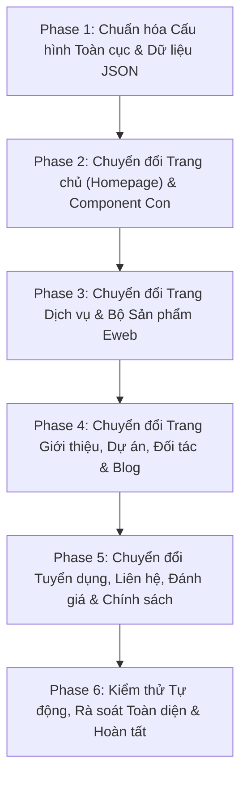

# KẾ HOẠCH TRIỂN KHAI CẬP NHẬT NỘI DUNG E-GEAD COMPANY

## Mục tiêu Dự án
Chuyển đổi hoàn toàn nội dung từ thương hiệu mẫu cũ (SAI Digital - Concentrix) sang **E-GEAD Company** dựa trên dữ liệu chuẩn từ [https://egeadcompany.com/](https://egeadcompany.com/).

### Nguyên Tắc Bất Biến (Ground Rules)
1. **Không thay đổi cấu trúc mã nguồn và layout component**: Giữ nguyên toàn bộ JSX elements, CSS Tailwind classes, responsive breakpoints, IDs và animations.
2. **Loại bỏ 100% dấu vết thương hiệu cũ**: Thay thế toàn bộ text, tiêu đề, meta tags, thông tin trụ sở, email, số điện thoại, đường link nội bộ cũ.
3. **Bảo đảm tính toàn vẹn hệ thống**: Đảm bảo Next.js build thành công, không lỗi hydration hay đứt gãy schema dữ liệu.

---

## Lộ Trình Triển Khai (Phases Breakdown)

---

### Phase 1: Chuẩn Hóa Cấu Hình Toàn Cục & Dữ Liệu JSON
- **Mục tiêu**: Thiết lập nền móng nhận diện thương hiệu, SEO metadata và dữ liệu tĩnh cấp cao.
- **Tệp tác động**:
  - `app/layout.tsx`: Cập nhật MetadataBase, SEO Title, Description, OpenGraph, Favicon sang E-GEAD Company.
  - `data/homepage.json`: Thay thế toàn bộ payload JSON bằng schema đã brainstorm tại [09_BRAINSTORM_GLOBAL_COMPONENTS_DATA_PAYLOADS.md](file:///c:/Develop/egead/egead-company/docs/contents/brainstorms/09_BRAINSTORM_GLOBAL_COMPONENTS_DATA_PAYLOADS.md).
  - `data/nav_tree.json`: Cập nhật cây điều hướng chuẩn theo sitemap mới.
  - `components/Header.tsx`, `components/Footer.tsx`, `components/MegaMenu.tsx`: Cập nhật Logo E-GEAD, menu điều hướng, thông tin liên hệ Buôn Ma Thuột, các múi giờ giao thương e-commerce và bản quyền `© 2026 E-Gead Company`.
- **Tiêu chí hoàn thành**: Toàn bộ Header, Footer và thẻ Meta hiển thị đúng chuẩn thương hiệu E-GEAD.

---

### Phase 2: Chuyển Đổi Trang Chủ (Homepage) & Các Component Con
- **Mục tiêu**: Đưa thông điệp "Automate Operations, Scale Global Sales" và các năng lực cốt lõi lên mặt tiền website.
- **Tệp tác động**:
  - `components/HeroBanner.tsx`: Cập nhật Announcement Pill (`US POD · Under 24h`), H1 (`AUTOMATE OPERATIONS. SCALE GLOBAL SALES.`), phụ đề và giữ nguyên đồng hồ thời gian thực.
  - `components/ServicesSection.tsx`: 4 thẻ dịch vụ (US POD Fulfillment, Sales Automation, Digital Growth Marketing, Developers Hub & WMS).
  - `components/CaseStudiesSection.tsx`: 4 case study thực chiến (TikTok Shop US, Amazon & Etsy sync, Ads ROAS 4.8x, WMS API integration).
  - `components/SmartCXSection.tsx`: Tinh chỉnh thành giải pháp độc quyền Eweb Suite (Eweb-character, Eweb-platform, Eweb-builder).
  - `components/PartnerSlider.tsx`: Logo các sàn Amazon, TikTok Shop, Etsy, Shopify, eBay, Google, Meta.
  - `components/TestimonialsSection.tsx`: Nhận xét từ các seller quốc tế tiêu biểu.
  - `components/InsightsSection.tsx`: 3 bài viết chuyên sâu về thị trường quốc tế.
  - `components/CultureSection.tsx`: Cập nhật các con số thực tế (100+ Projects, 20+ Partners, 10+ Countries, 99% Satisfaction).
  - `components/ContactBlock.tsx`: Kêu gọi hành động tư vấn vận hành TMĐT.
- **Tiêu chí hoàn thành**: Trang chủ hoàn thiện 100%, không còn từ khóa cũ, nội dung hấp dẫn chuẩn chuyển đổi.

---

### Phase 3: Chuyển Đổi Trang Dịch Vụ & Bộ Sản Phẩm Eweb
- **Mục tiêu**: Chi tiết hóa năng lực kỹ thuật và giải pháp công nghệ độc quyền của E-GEAD.
- **Tệp tác động**:
  - `app/services/all-services/page.tsx`: Cập nhật mảng `servicePillars` với 6 dịch vụ chủ lực (Sales Automation, POD Marketplace Integration, Fulfillment Automation, E-Commerce Platform, Website & Hosting, Digital Advertising Services) kèm 3 sub-services chi tiết cho mỗi nhóm.
  - `app/smartcommerce/page.tsx`: Định vị lại thành **Eweb-platform** (Bảng điều khiển trung tâm đồng bộ đa sàn, quản trị kho WMS và đối soát biên lợi nhuận ròng tức thì).
  - `app/speedx/page.tsx`: Định vị lại thành **Eweb-character** (Hệ thống AI chuẩn hóa địa chỉ, giảm RTO, và sản xuất POD tại Mỹ dưới 24 giờ với giá $6 all-in).
- **Tiêu chí hoàn thành**: Các trang dịch vụ và sản phẩm cung cấp thông tin chuyên sâu, giải quyết trúng nhu cầu của khách hàng.

---

### Phase 4: Chuyển Đổi Trang Giới Thiệu, Dự Án, Đối Tác & Blog
- **Mục tiêu**: Xây dựng uy tín thương hiệu thông qua câu chuyện doanh nghiệp, bằng chứng thành công và nội dung chuyên môn.
- **Tệp tác động**:
  - `app/company/page.tsx`: Tuyên ngôn "More Than An Operations Partner", trụ sở Buôn Ma Thuột, mạng lưới xưởng in Mỹ, 4 giá trị DNA cốt lõi.
  - `app/our-work/page.tsx`: Cập nhật 4 case study chi tiết với bộ lọc ngành TMĐT mới (`pod-fulfillment`, `marketplace-sync`, `performance-ads`, `api-integration`).
  - `app/partners/page.tsx`: Cập nhật hệ sinh thái đối tác sàn (Amazon, TikTok Shop, Etsy, Shopify, Meta/Google, USPS).
  - `app/insights/page.tsx` & `app/articles/[slug]/page.tsx`: Cập nhật 4 bài viết blog chiến lược về mở rộng thị trường, SLA TikTok Shop US, WMS mã vạch và tối ưu giá in POD.
- **Tiêu chí hoàn thành**: Hệ thống bài viết và nghiên cứu tình huống hoàn chỉnh, liên kết hoạt động tốt.

---

### Phase 5: Chuyển Đổi Tuyển Dụng, Liên Hệ, Đánh Giá & Chính Sách
- **Mục tiêu**: Hoàn thiện các kênh tương tác, tuyển dụng và minh bạch pháp lý.
- **Tệp tác động**:
  - `app/career/page.tsx`: Danh sách 5 vị trí tuyển dụng thực tế tại Buôn Ma Thuột và hình thức Remote.
  - `app/contact-us/page.tsx`: Địa chỉ thực tế 217/9 Ngô Quyền, Buôn Ma Thuột; các tùy chọn danh mục tư vấn phù hợp với nhu cầu seller.
  - `app/testimonial/page.tsx`: 6 đánh giá chất lượng từ các nhà sáng lập và quản lý vận hành bán lẻ toàn cầu.
  - `app/privacy-policy/page.tsx` & `app/sai-privacy/page.tsx`: Chính sách bảo mật dữ liệu đơn hàng TMĐT, mã hóa API và cam kết tuân thủ GDPR/CCPA.
- **Tiêu chí hoàn thành**: Thông tin liên hệ và pháp lý đồng nhất 100% với website thực tế.

---

### Phase 6: Kiểm Thử Tự Động, Rà Soát Toàn Diện & Nghiệm Thu
- **Mục tiêu**: Đảm bảo chất lượng kỹ thuật, không có liên kết hỏng, build sản phẩm không phát sinh lỗi.
- **Các bước thực hiện**:
  1. Chạy lệnh build kiểm tra: `bun run build` (hoặc `npm run build`).
  2. Kiểm tra toàn bộ đường dẫn URL nội bộ (internal links), đảm bảo không dẫn tới các trang cũ đã bị loại bỏ.
  3. Quét kiểm tra văn bản (Grep search) để xác nhận không còn từ khóa như `Concentrix`, `SAI Digital`, `Suntory PepsiCo` trong mã nguồn.
- **Tiêu chí hoàn thành**: Toàn bộ dự án build thành công ở trạng thái production, sẵn sàng deploy.

---

## Tiếp Theo
Để bắt đầu triển khai các pha trên vào mã nguồn, người dùng có thể kích hoạt kỹ năng/lệnh `/cook` hoặc yêu cầu thực thi từng pha cụ thể.
